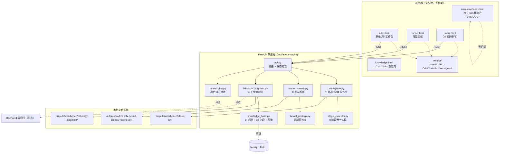
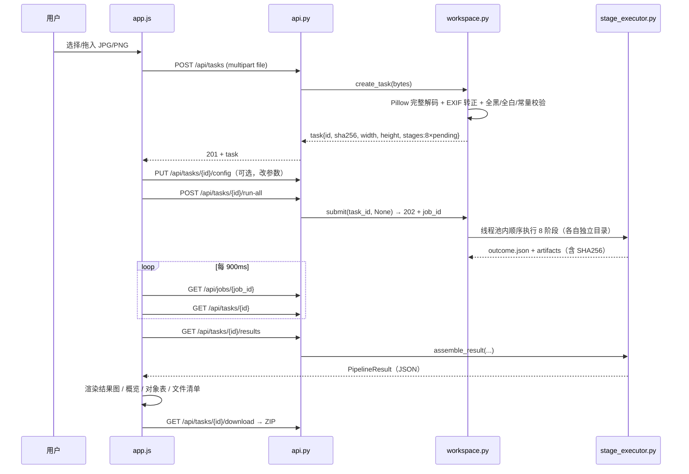
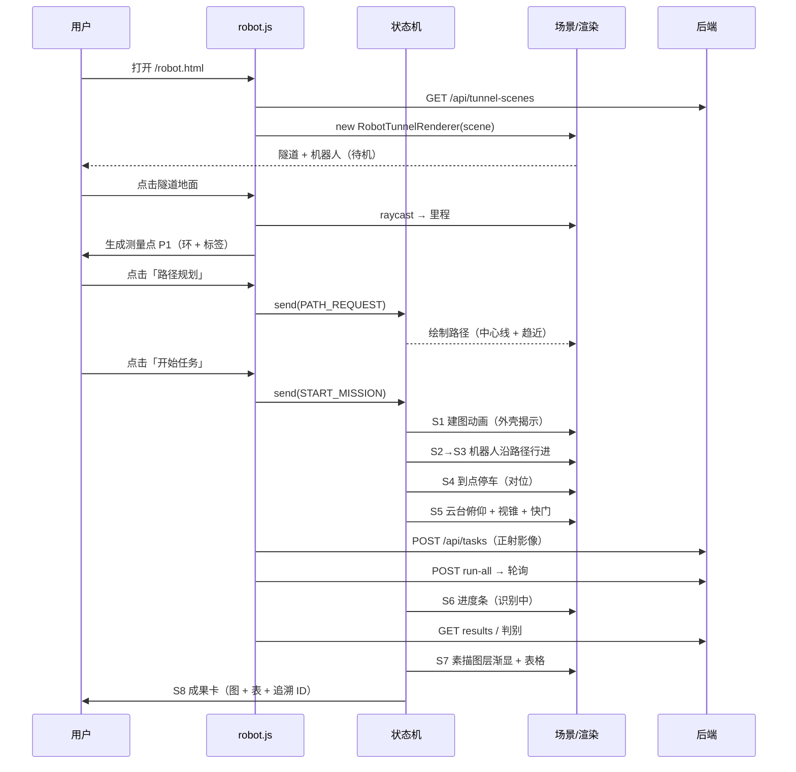
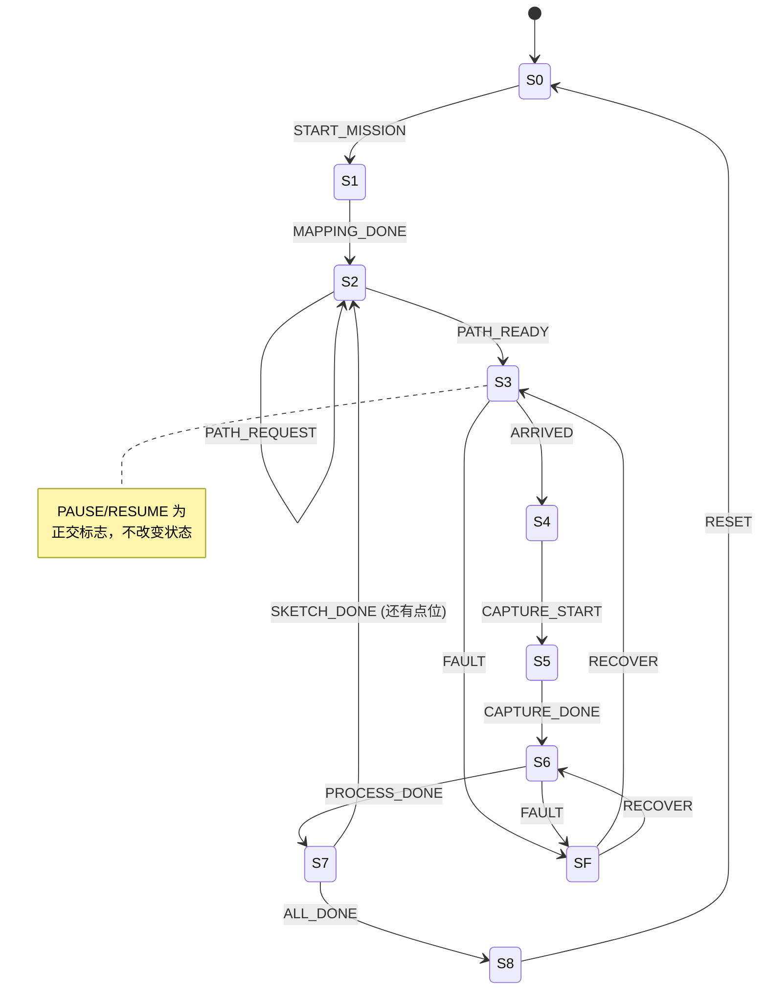
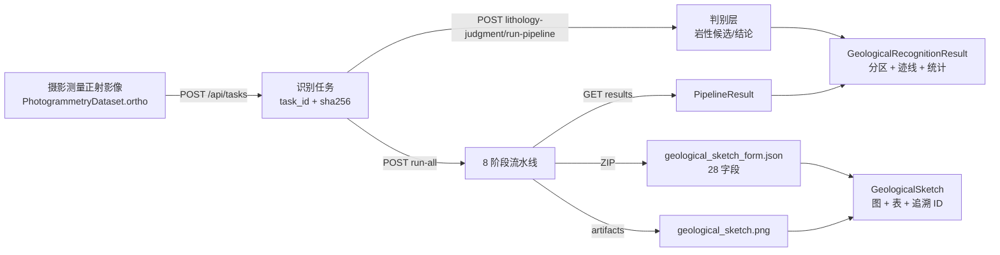
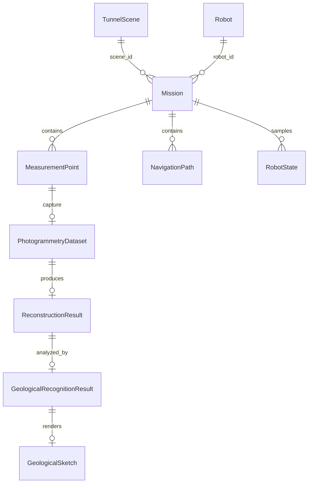

# 机器人交互模块 · 架构审查与接入设计

> 文档性质：**只读架构审查 + 开发任务书**。本阶段未修改任何现有源代码，未安装依赖，未新建独立机器人工程。
> 审查对象：`E:\横向项目\5=侨城东路\掌子面智能地质素描开发\project`
> 审查时间：2026-10-30
> 结论基于实际读取的代码与资产实测数据，凡未验证项均标注 **待核实**。

---

## 0. 结论摘要（先看这一页）

### 0.1 一句话结论

现有平台已经具备机器人模块所需的**三块地基**——可编程的三维隧道场景（Three.js 0.186.1，纯前端、无构建）、可被 HTTP 调用的八阶段识别流水线（FastAPI，任务级不可变成果）、以及按里程摆放掌子面断面的空间数据模型；缺少的是**机器人实体、任务状态机、任务级数据容器**三样东西。因此机器人交互模块应当作为**第四个页面 + 一套纯 JS 领域模块**接入，复用 `TunnelRenderer` 与识别 API，**不重建场景、不重写算法**。

### 0.2 十个关键判断

| # | 问题 | 结论 | 证据 |
|---|---|---|---|
| 1 | 前端框架 / 构建工具 | 无框架、无构建、无 npm、无 TypeScript；原生 ES Module 静态页，由 FastAPI `StaticFiles` 直接托管 | `src/face_mapping/api.py:180-182`；仓库内无 `package.json`（仅 `.tmp/fg/package/package.json` 为临时产物） |
| 2 | 三维引擎 | Three.js **0.186.1**，本地 vendor（含 MIT 许可与哈希清单），`importmap` 映射 `three` 与 `three/addons/` | `frontend/vendor/manifest.json`；`frontend/tunnel.html:9` |
| 3 | 后端 | Python 3.12 + FastAPI 0.143.5 + uvicorn，**单进程单工作线程池** | `pyproject.toml`；`src/face_mapping/workspace.py:325-342`；`api.py:100` |
| 4 | 数据存储 | 本地文件系统（JSON + PNG/JPEG + ZIP），无数据库；知识图谱可选 Neo4j | `workspace.py:63-110`；`tunnel_scenes.py:125-158` |
| 5 | 通信方式 | REST/JSON + multipart 上传；长任务返回 **202 + 作业轮询**，无 WebSocket/SSE | `api.py:139-149`；`frontend/app.js:1843-1860` |
| 6 | 是否有统一 API 层 | **没有**。每个页面各自实现 `api()` 封装，逻辑重复 | `frontend/app.js:63`、`frontend/tunnel.js:17` |
| 7 | 隧道三维模型格式 | **不是模型文件**，而是由 5 个参数程序化生成的示意直筒隧道 | `frontend/tunnel_renderer.js:104-152`；`frontend/tunnel_geometry.js:7-15` |
| 8 | 能否直接加载机器人 GLB | **能，但需补 4 件事**：GLTFLoader、灯光/环境、渲染循环、资产路由。场景当前**没有任何灯光**，且为按需渲染 | 见 §2.4.3、§7.1 |
| 9 | 单张识别能否被机器人调用 | **能**（HTTP 层完全可复用），但缺"一次调用跑完整链路"的编排接口与任务级来源元数据 | 见 §2.3.6 |
| 10 | 是否存在机器人相关代码 | **完全没有**。`frontend/` 与 `src/` 中无 robot/mission 相关标识 | 全文检索 robot / Robot / 机器人 / 履带，在 `src/*.py` 中仅 1 处无关注释 |

### 0.3 必须在开工前接受的三个事实

1. **隧道场景是"示意"，不是测量模型。** 场景 JSON 明确写入 `"coordinate_system": "local_tunnel_m"`、`"illustrative": true`、`"geometry_method": "straight_illustrative_tunnel"`、`"alignment_status": "illustrative_unregistered"`。**当前不存在任何模型坐标 ↔ 工程绝对坐标的转换关系**。机器人定位若直接宣称"隧道内真实位置"即为不实陈述。
2. **机器人 GLB 是"静态产品资产"，不是"可驱动角色"。** 实测：136 节点 / 128 网格 / 25 材质 / **0 动画 / 0 贴图** / 440,652 三角面 / 10.5 MB。左右履带、三相机、门架均可独立寻址（命名规范完整），但履带是**单张无贴图的静态网格**，"履带滚动"没有现成实现。
3. **平台的"全流程"是浏览器编排的，不是后端编排的。** `run-all` 只跑 8 个识别阶段；岩性判别是另一组接口，由 `app.js` 在前端串起来（`frontend/app.js:1861`）。机器人模块若直接照抄，会把同一段编排逻辑复制第三份。

---

## 1. 审查方法与证据基线

### 1.1 Git 基线（审查前后一致）

| 项目 | 值 |
|---|---|
| 分支 | `codex/geology-links-demo` |
| 审查前 HEAD | `896d315`（`feat: add geometry modules and workbench workflow`） |
| 本轮推送 | `896d315..2fc3588`（27 个文件 / 41,021,392 B，全部为 `robot/` 资产） |
| 远程 | `https://github.com/HouDebang/tunnel-face-mapping.git`（Private） |
| 审查前工作区 | 干净（仅 `robot/` 未跟踪，已随本轮提交） |
| 审查后工作区 | 仅新增本报告文件（未跟踪），**无任何既有文件被修改** |

> 说明：本机 `git` 不在 `PATH`，实际使用 `C:\Users\pc\.cache\codex-runtimes\codex-primary-runtime\dependencies\native\git\cmd\git.exe`（2.53.0）。仓库配置了 `http.proxy=127.0.0.1:7897` 与 gh 凭据助手，推送正常。

### 1.2 实际读取的文件（节选，均为本次逐行阅读）

- 配置与入口：`pyproject.toml`、`start.bat`、`configs/default.yaml`、`README.md`(271 行)、`GIT_GUIDE.md`
- 前端：`frontend/index.html`(77)、`frontend/app.js`(1956)、`frontend/tunnel.html`(150)、`frontend/tunnel.js`(173)、`frontend/tunnel_renderer.js`(351)、`frontend/tunnel_geometry.js`(29)、`frontend/geology_renderer.js`(50)、`frontend/knowledge.html`(21)、`frontend/style.css`/`tunnel.css` 的 `:root` 令牌、`frontend/vendor/manifest.json`
- 后端：`api.py`(186)、`workspace.py`(478，重点 110-380)、`stage_graph.py`(31)、`stage_executor.py`(482，重点 1-50/130-240)、`schemas.py`(148)、`tunnel_scenes.py`(458，重点 1-330)、`tunnel_geology.py`(函数级)、`lithology_judgment.py`(函数级)、`export.py`(240，重点 88-233)、`config.py`(函数级)、`pipeline.py`(函数级)
- 资产：`robot/Tracked_Photogrammetry_Robot/README.md`(344)、`build_robot.py`(2684，函数级)、`Tracked_Photogrammetry_Robot.glb`（二进制解析）
- 数据：`outputs/workbench/.tunnel-scenes/*/scene.json`（实测 2,994,825 B 的真实场景）
- 动画：`animation/README.md`、`animation/app.js`（时间轴部分）

### 1.3 审查手段

- 静态阅读 + 结构解析：用项目自带 `.venv` 的 Python 直接解析 GLB 的 JSON chunk，遍历节点层级并做 TRS 矩阵累乘，得到**世界包围盒**（非读取 README 的宣称值）。
- 交叉验证：README 宣称值与实测值逐项比对（§3.2）。
- 未运行完整测试套件（避免产生运行数据）。README 只给出测试命令（`README.md:137`：`pytest -q --junitxml=outputs/test_results.xml`），**未声明通过数量**，故测试现状标注为**待核实**。

---

## 2. 第一部分：现有平台全面审查

### 2.1 技术架构

#### 2.1.1 逐项确认（对应任务书 3.1 的 10 问）

| 问项 | 实测结论 | 证据位置 |
|---|---|---|
| 1 前端框架 | **无**。原生 DOM + ES Module，页面内用 `node()/replace()` 手写节点工厂 | `frontend/app.js:38-52`；`frontend/tunnel.js:10` |
| 2 构建工具 | **无**。静态文件由后端直接托管，改完刷新即生效 | `src/face_mapping/api.py:180-182` |
| 3 UI 组件库 | **无**。自建 CSS 设计令牌 + 类名体系（`button primary/secondary`、`status-pill`、`panel-eyebrow`） | `frontend/style.css` 的 `:root`；`frontend/index.html:16` |
| 4 TypeScript | **否**。全部 `.js`，无 `tsconfig.json` | 仓库检索 |
| 5 三维引擎 | **Three.js 0.186.1**（`three.module.js` + `three.core.js` + `OrbitControls.js`），WebGL2；另有 force-graph（知识图谱 2D） | `frontend/vendor/manifest.json`；`frontend/tunnel_renderer.js:1-2` |
| 6 后端技术 | Python 3.12 + FastAPI + uvicorn + Pydantic v2 + OpenCV/scikit-image/Pillow | `pyproject.toml`；`requirements-lock.txt` |
| 7 数据存储 | 文件系统：任务目录、执行目录、场景目录、判别状态；无关系库 | `workspace.py:63-110`；`tunnel_scenes.py:125-158` |
| 8 前后端通信 | HTTP REST/JSON；上传用 multipart；长任务 202 + `GET /api/jobs/{id}` 轮询 | `api.py:106-116,139-149`；`app.js:1843` |
| 9 统一 API 层 | **不存在**。`api()` 在两个页面各写一份（约 10 行/份） | `app.js:63-72`；`tunnel.js:17` |
| 10 统一数据管理 | **部分存在**。`Workspace` 管任务、`TunnelSceneStore` 管场景、`LithologyJudgmentStore` 管判别；三者互不知晓，无统一"项目/任务"实体 | `workspace.py:63`；`tunnel_scenes.py:125`；`lithology_judgment.py:162` |

#### 2.1.2 架构图



#### 2.1.3 架构上的三个真实特征（会直接影响机器人模块）

**特征 A：单进程 + 全局锁 + 单工作线程池。**
`Workspace.__init__` 建立 `ThreadPoolExecutor`，`_run_job` 全程持 `self.lock` 的临界区读写 `task.json`；`api.py:100` 的健康检查自述 `"execution_model":"single_process_single_worker"`。含义：**机器人演示期间触发的识别任务会与工作台任务串行排队**，一次全流程约数十秒（取决于图像尺寸），演示节奏必须按"异步 + 进度提示"设计，不能假设秒回。

**特征 B：成果是不可变的、按内容寻址的。**
每个阶段执行产出独立目录 + `outcome.json`，缓存键由"源文件 SHA256 + 阶段参数 + 相关源码哈希 + 上游成果哈希 + 坐标约定"组成（`workspace.py:181-199`）。含义：机器人重复采集同一张图**不会**误用旧结果，但也**不会**自动去重成同一任务——每次上传都是新任务。

**特征 C：前端是"展示器"，不是"计算器"。**
`app.js:3-4` 的注释明确写着"浏览器只呈现 Python 产物，识别、测量、配置校验、缓存判定都在服务端"。含义：机器人模块**不得**在前端做任何几何/识别计算，只能做运动学与可视化。这条边界必须继承。

### 2.2 页面与模块结构

#### 2.2.1 页面结构树

```
/  (index.html · 单张识别工作台)
├── header.topbar
│   ├── brand + version "MVP / 03"
│   └── top-actions: 连接状态 / 知识库抽屉 / 大模型抽屉 / 上传照片 / 运行全部步骤 / 导出成果
├── nav.workspace-switcher                     ← 唯一的主导航（2 项）
│   ├── a[href="/"]           单张识别（active）
│   └── a[href="/tunnel.html"] 隧道三维
├── div.taskbar: 当前照片 / 历史任务下拉 / 总体状态
├── main.workbench
│   ├── aside.steps-panel  ← 8 步流程导航（含"裂缝与几何分析"父流程分组）
│   └── section.main-panel
│       ├── stage-heading + stage-actions（强制重算 / 恢复默认 / 保存 / 运行后续 / 运行当前）
│       ├── 双图对照（输入视口 + 结果视口 + sketch-canvas 叠加层 + 图层开关）
│       └── section.console（参数 / 子步骤 / 结果概览 / 对象数据 / 输出文件 / 执行日志）
└── 全局：toast、error-dialog

/tunnel.html  (隧道三维)
├── header.topbar
│   ├── brand（返回工作台）
│   └── top-actions: 徽标"流程示意·非测量模型" / ← 单张识别
├── aside.controls
│   ├── 01 TUNNEL SCENE   场景新建/选择/起止里程/示意宽高
│   ├── 02 ADD SECTION    选任务 + 成果来源(素描/原图) + 里程 → 添加断面
│   ├── 03 SECTIONS       断面列表 + 摆放参数（宽高/偏移/旋转/翻转/显隐）
│   └── 04 GEOLOGICAL LINKS 裂隙连接 / 岩性界面 / 手动配对 / 连接管理
└── section.stage
    ├── TunnelRenderer 视图（透视/正视/侧视/俯视 + 外壳透明度 + 断面透明度）
    ├── 图例、选中说明、示意水印
    └── section.chat-card（项目知识对话）

/knowledge.html  → 立即 location.replace("/?kb=rocks")（历史入口兼容，已不再独立）

/animation/index.html  → 独立的 1920×1080 60s 概念片，未被主应用链接
```

#### 2.2.2 主导航定义在哪里

- **正规定义点只有一处**：`frontend/index.html:18` 的 `<nav class="workspace-switcher">`，包含两个 `<a>`。
- `tunnel.html` **没有**这个 switcher，它用 `header.top-actions` 里的"← 单张识别"作为返回（`frontend/tunnel.html:15`）。
- 含义：新增第三个模块时，**没有可复用的导航组件**。要么在三个页面各写一遍（3 处重复），要么抽一个 `frontend/nav.js`（需改动两个既有页面）。本设计建议：M1 先"各写一遍 + 统一结构"，把抽取放到 P2（§10.5）。

#### 2.2.3 页面之间如何切换

纯多页跳转（`<a href>` / `location.href`），**无前端路由、无 SPA**。深链靠 URL 查询参数恢复状态：

| 参数 | 作用 | 定义处 |
|---|---|---|
| `?task=<id>` | 恢复识别任务 | `app.js:1933` |
| `?stage=<id>&tab=<...>&substep=<...>` | 恢复步骤/页签/子步骤 | `app.js:1935-1948` |
| `?kb=rocks\|fields\|graph` | 打开知识库抽屉 | `app.js:1950-1953` |
| `?scene=<id>` | 恢复隧道场景 | `tunnel.js:112`（写入）、`tunnel.js:171`（读取） |
| `?provider=1` | 打开大模型抽屉 | `app.js:1949` |

机器人模块应沿用同一约定：`/robot.html?mission=<id>&point=<id>&mode=interactive|demo`。

#### 2.2.4 可复用的通用组件（真实存在，可直接用）

| 组件 | 位置 | 复用方式 | 复用风险 |
|---|---|---|---|
| `TunnelRenderer`（含场景/相机/拾取/截图） | `frontend/tunnel_renderer.js:9` | **继承**或组合，加机器人组 | 低（未封闭，属性可访问） |
| 隧道剖面生成 `profilePoints` / 里程格式化 `formatChainage` | `frontend/tunnel_geometry.js:7,17` | 直接 import | 无 |
| 地质连接图层 `GeologyLayer` | `frontend/geology_renderer.js:5` | 不必须；机器人页可省 | 无 |
| `node()/replace()` DOM 工厂 | `app.js:38-52`、`tunnel.js:10` | 复制到 `robot.js`（约 15 行） | 无（重复但安全） |
| `api()` fetch 封装 | `app.js:63`、`tunnel.js:17` | 复制或抽 `frontend/api_client.js` | 低 |
| `status-pill` / `button` / `panel-eyebrow` 等样式 | `frontend/style.css` `:root` | 直接引用 `style.css` 或复制令牌 | 低 |
| 知识对话卡片 | `frontend/tunnel.html:116-143` | 机器人页可作为"任务问答"复用 | 中（依赖 scene 上下文） |
| 场景/断面数据模型与存储 | `src/face_mapping/tunnel_scenes.py:33-95,125-158` | 机器人任务存储**照此模式**新建 | 低（模式复制，不改原文件） |

#### 2.2.5 各模块之间是否共享数据

**当前是"单向引用"，不是"共享状态"**：

- 隧道三维 **引用** 识别成果：`SectionCreate.task_id + execution_id`，添加断面时把 `geological_sketch.png` 与 `original.png` 冻结成 1024px JPEG 快照（`tunnel_scenes.py:206-226`），并记录 `source_sha256`。
- 识别模块 **不知道** 隧道场景的存在（`app.js` 中无任何 scene 引用）。
- 两个模块共享的只有：同一个 `Workspace` 根目录、同一套任务 ID、同一个后端进程。

含义：机器人模块必须成为**第一个双向枢纽**——它既要知道场景（里程/坐标），又要引用识别任务。这会第一次把"场景 ↔ 任务"的关联变成多对多，需要在数据层显式建模（§6）。

### 2.3 单张识别模块审查

#### 2.3.1 完整工作流程（代码级）



关键代码位置：
- 上传与校验：`api.py:106-116` → `workspace.py:117-158`（32 MiB、4000 万像素、后缀/MIME/内容三重一致、MPO 主图）
- 阶段定义：`stage_graph.py:2-11`（8 阶段 + 依赖 + 可选依赖）
- 缓存与失效：`workspace.py:181-199`（`_cache_key`）、`201-232`（`_fresh` 重哈希校验）
- 执行：`workspace.py:363-455`（`_run_job`，前置递归 + 失败隔离）
- 汇总：`stage_executor.py:135-186`（`assemble_result`，缺失分支为 null，绝不回填旧结果）
- 前端轮询：`app.js:1843-1860`（900 ms 间隔）

#### 2.3.2 图像上传与预处理

| 环节 | 实现 |
|---|---|
| 上传方式 | 文件选择（`index.html:16`）+ 拖放（`app.js:1921-1923`），仅 `.jpg/.jpeg/.png` |
| 体积/像素上限 | 32 MiB / 4000 万像素（`workspace.py:34-35`） |
| 预处理 | Pillow 验证 → `ImageOps.exif_transpose` → RGB → 等比缩到 `max_dimension=1280` → 可选 LAB CLAHE（`configs/default.yaml:2-5`） |
| 坐标系 | 左上原点、x 右、y 下、像素中心 `(col+0.5,row+0.5)`；**所有成果都在 EXIF 转正后的原图坐标系**（`schemas.py:9,26`） |

#### 2.3.3 模型调用方式

**没有外部模型权重、没有联网推理。** 三条路径：

1. **内置算法**（默认）：`face_detection`（central_texture / grabcut）、`lithology`（kmeans / slic）、`fracture_detection`（blackhat_hessian / blackhat / frangi）、`vectorization`（骨架 + 逐边追踪）。
2. **可插拔后端协议**：`backends.SegmentationBackend.predict(image, roi_mask, config)`（`README.md:256`），可注入自定义实现，但**当前只实现了两个 Baseline**。
3. **大模型（可选增强）**：仅用于**岩性判别**，OpenAI 兼容接口，Key 只存后端（`lithology_judgment.py:179` 配置文件路径、`:744-812` provider 与鉴权函数），不参与分割/几何。

#### 2.3.4 识别结果的数据结构（这是机器人联动的契约核心）

顶层：`PipelineResult`（`schemas.py:133-148`）

```text
PipelineResult
├── schema_version / algorithm_version / coordinate_system
├── status: completed_with_warnings | partial | failed
├── image: ImageMetadata          ← 尺寸、缩放矩阵、EXIF 是否转正、输入 SHA256
├── face: FaceRegion              ← 候选掌子面范围（verified 默认 false）
├── lithology_regions: LithologyRegion[]
├── fractures: FractureTrace[]
├── statistics: GeometricStatistics
├── calibration: {...}
├── algorithms: {...}             ← 实际生效的算法与阈值（可审计）
├── topology: {...}               ← 骨架图拓扑与边账本
├── config: {...}                 ← 本次完整配置
└── quality: QualityReport        ← 步骤状态、检查项、警告、限制声明
```

**岩性结果的表达是两层的，必须区分清楚**：

| 层 | 载体 | 表达 | 是否给出岩石名称 |
|---|---|---|---|
| 分割层 | `LithologyRegion`（`schemas.py:43-53`） | `region_id`、`label_value`、`polygon`、`pixel_area`、`mask_path` | **否**。`category: Literal["unknown"]` 硬编码 |
| 判别层 | `lithology_judgment` 状态（`lithology_judgment.py:561` 的 `state()`） | 每区域：候选岩性 + 相对支持度（softmax 温度 0.15）+ 知识证据 + 大模型结论 | **是（候选/暂定/确认/冲突）** |

> 结论：**"岩性识别"在本平台中从来不是分割阶段给出的**。机器人模块展示"岩性分区"时应取判别层的 `final_judgment`，并在无判别时明确显示 `unknown / 需复核`。这一点若做错，会直接产出"伪岩性结论"。

**结构面结果的表达**：`FractureTrace`（`schemas.py:56-80`）

```text
id / points（完整坐标） / display_points（仅绘图） / start_node / end_node / is_closed
source / detection_source
length_px（+ length_m，仅在标定后）
endpoint_direction_deg / principal_direction_deg   ← 轴向 [0,180)，不是走向/倾角
roughness_index / tortuosity / angular_variability_deg / texture_gradient_rms
aperture_mean_px / aperture_max_px / aperture_mean_m / aperture_max_m / aperture_sample_count
status = "candidate_fracture_trace"
```

统计量：`GeometricStatistics`（`schemas.py:83-102`），含 `p21_per_px`、`p21_per_m`、`mean_roughness_index`、`mean_aperture_px`、`image_strike_deg`、`strike_azimuth_deg`、`dip_deg`（**恒为 null**，单张二维照片不推导倾角）。

#### 2.3.5 展示与导出

- 展示：双图对照 + 叠加层（`sketch-canvas` 手绘图层，`app.js:273` `drawSketch`），图层开关只改显示不改计算（`index.html:45`）。
- 导出：ZIP（`api.py:168-171`）+ `parameters.csv` + `results.json` + `quality_report.json` + `manifest.json` + `geological_sketch_form.json/csv`（28 字段，`export.py:190-232`）。
- 28 字段表中，**自动填充项与"需外部输入"项严格分离**：粗糙度/张开性/产状即便有值也标为非 auto（`export.py:202-207`）。

#### 2.3.6 能否被机器人直接调用？—— 判断与缺口

**能调用的部分（HTTP 层完全复用，无需改后端）**：

| 能力 | 接口 | 机器人用途 |
|---|---|---|
| 建任务 | `POST /api/tasks` | 把摄影测量得到的正射影像当"一张照片"提交 |
| 全流程 | `POST /api/tasks/{id}/run-all` → 202 | 自动跑 8 阶段 |
| 进度 | `GET /api/jobs/{job_id}` | 驱动状态机 S6→S7 |
| 结果 | `GET /api/tasks/{id}/results` | 取分区/迹线/统计 |
| 成果图 | `GET /api/tasks/{id}/artifacts/{artifact_id}` | 取 `geological_sketch.png` |
| 素描表 | ZIP 内 `geological_sketch_form.json` | 生成成果表 |
| 岩性判别 | `POST /api/tasks/{id}/lithology-judgment/run-pipeline` | 补上岩性名称 |

**五个真实缺口**：

1. **无"一次调用跑完整链路"的接口。** `run-all` 不含判别；判别是另一组接口。前端 `runCombinedJudgment()`（`app.js:1861-1871`）在做这件事。机器人若照抄 → 第三份编排逻辑。
2. **无同步返回。** 只能 202 + 轮询，最小轮询间隔由前端自定（900 ms）。机器人状态机必须容忍 20–60 s 的 S6 停留。
3. **任务无来源元数据。** `create_task` 只记录 `filename/sha256/width/height`（`workspace.py:153-155`），**没有**"哪台设备、哪个里程、哪个测量点、什么姿态"的字段。追溯链只能靠机器人侧自己保存 `task_id`。
4. **无幂等键。** 同一张图重复提交会生成两个任务、两套成果。演示重播时会累积垃圾任务。
5. **无任务级"项目"归属。** `/api/tasks` 返回全局列表，机器人无法只列出"本次任务产生的图"。

**需要的适配层（结论）**：

- 前端：`frontend/recognition_client.js`，封装 `analyze(blob, meta) → {taskId, executionId, sketchUrl, form, stats}`，内部完成"上传 → run-all → 轮询 → 判别 → 取结果"，**只给机器人模块用**，不改 `app.js`（零回归风险）。
- 后端（M4 可选）：`POST /api/tasks/{id}/analyze-all`，把 8 阶段 + 判别合成一个 job，返回统一 `RecognitionBundle`。收益是去掉前端编排；成本约 80 行 + 2 个测试。

### 2.4 隧道三维模块审查

#### 2.4.1 模型格式与加载方式

**当前没有任何模型文件被加载。** 隧道是**程序化生成**的：

- `TunnelRenderer.buildTunnel(data)`（`tunnel_renderer.js:104-152`）读取 5 个标量：`start_chainage_m`、`end_chainage_m`、`width_m`、`height_m`、`chainage_prefix`。
- 断面轮廓由 `profilePoints(width, height, segments=32)`（`tunnel_geometry.js:7-15`）生成：底部矩形 + 半圆拱，共约 35 个点。
- 沿 X 方向把轮廓拉伸成三角带（`tunnel_renderer.js:113-124`），得到"外壳"网格；再加 `GridHelper`、每 `niceStep` 米一圈轮廓线、中线、里程箭头与文字 Sprite。

**含义**：不存在"导入隧道模型"这一步，也不存在 LOD、材质贴图、法线。改造点少、可控性强，但**无法表达曲线隧道、变截面、真实超欠挖**。

#### 2.4.2 坐标系、尺度与绝对坐标

| 项 | 值 | 证据 |
|---|---|---|
| 世界轴 | **+X 里程增大；+Y 向上；+Z 面向里程增大方向的右侧** | `tunnel_renderer.js:6-8`；场景 JSON `coordinate_axes` |
| 单位 | 米（`chainage_m`、`width_m`、`height_m`、`offset_u_m/v_m`） | `tunnel_scenes.py:33-75` |
| 断面位置 | `[chainage - start, height*0.4 + offset_v, offset_u]` | `tunnel_geometry.js:2-5`；`tunnel_scenes.py:190-192` |
| 断面朝向 | `group.rotation.y = -π/2` → 平面法线指向 **-X**（朝洞口方向） | `tunnel_renderer.js:172` |
| 断面内旋转 | `imageGroup.rotation.z = rotation_deg` | `tunnel_renderer.js:175` |
| 场景坐标系标识 | `"coordinate_system": "local_tunnel_m"` | 实测 scene.json |
| 与工程绝对坐标的关系 | **不存在**。`"alignment_status": "illustrative_unregistered"`、`"geometry_method": "straight_illustrative_tunnel"`、`"illustrative": true` | 实测 scene.json |

> **这是全篇最重要的坐标结论**：目前只有"局部隧道米"，没有"模型坐标 → 工程坐标（如 CGCS2000 / 线路里程 + 偏移）"的变换，也没有曲线要素、坡度、超高等线路参数。机器人定位若要说"RK4+970 处"，只能理解为"该示意场景的第 4970 m 位置"，**不等于实测里程**。

#### 2.4.3 能否在现有场景中加载机器人 GLB 并让其移动

**结论：能，且不需要重建场景；但必须补齐 4 项能力，其中 1 项是硬缺陷。**

| 缺口 | 现状 | 影响 | 补法 |
|---|---|---|---|
| **① 没有 GLTFLoader** | `frontend/vendor/` 只有 `three.module.js`、`three.core.js`、`OrbitControls.js` | 无法 `new GLTFLoader()` | 从 three@0.186.1 的 `examples/jsm/` 复制 `loaders/GLTFLoader.js` 与 `utils/BufferGeometryUtils.js` 到 `frontend/vendor/`，现有 importmap `"three/addons/": "/vendor/"` 已可解析 |
| **② 场景没有任何灯光** | `tunnel_renderer.js` 只使用 `MeshBasicMaterial / LineBasicMaterial / SpriteMaterial`；全文无 `Light` | GLB 是 `MeshStandardMaterial`（PBR），**无光即全黑** | 加 `HemisphereLight` + `DirectionalLight`（+ 可选 `PMREMGenerator` 环境），并考虑 `toneMapping` |
| **③ 没有渲染循环** | `render()` 只在 `controls change` / 场景变更时调用（`tunnel_renderer.js:315`），`controls.enableDamping=false`（:44） | 机器人无法连续运动 | 机器人页启用 `renderer.setAnimationLoop()`，用脏标记避免空转 |
| **④ 资产不在静态目录** | `StaticFiles` 只挂 `frontend/`（`api.py:180-182`），GLB 在 `robot/` 下 | 浏览器取不到 GLB | 方案 A：`app.mount("/robot-assets", StaticFiles(directory=project/"robot"))`（3 行）；方案 B：把 10.5 MB GLB 复制进 `frontend/assets/`（Git 重复存储）。推荐 A |

**复用清单（具体到成员）**：

| 复用对象 | 用途 |
|---|---|
| `TunnelRenderer` 构造函数 | 建立 scene/camera/renderer/OrbitControls/ResizeObserver |
| `this.scene`、`this.camera`、`this.controls`、`this.renderer` | 机器人组挂载、跟随相机、截图 |
| `buildTunnel()` 产出的 `this.shell` / `this.shellLines` / `this.environment` | 作为机器人运动的物理背景与"已建图区域"遮罩对象 |
| `sectionPosition()` / `profilePoints()` / `formatChainage()` | 里程 ↔ 世界坐标换算、剖面点、里程标签 |
| `pick()` 的 Raycaster 机制 | 扩展为"点击地面设测量点" |
| `setView()` 的四视图 | 演示镜头预设 |
| `downloadScreenshot()` | 成果截图（需加机器人） |

#### 2.4.4 拾取、对象增删、变换、相机、图层（逐项）

| 能力 | 现状 | 位置 |
|---|---|---|
| 获取点击位置 | **有**，但只对断面网格做射线检测（`intersectObjects(sectionMeshes)`） | `tunnel_renderer.js:297-305` |
| 在场景中添加对象 | **有**（`environment` / `sections` 两个组，`scene.add`） | `tunnel_renderer.js:47-49` |
| 移动/旋转/缩放 | **有**（`group.position/rotation`，断面还支持 `mesh.scale.x=-1` 翻转） | `tunnel_renderer.js:171-181` |
| 相机控制 | OrbitControls（阻尼关闭、最小距离 0.5）+ 4 个硬编码机位 | `tunnel_renderer.js:43-46,270-295` |
| 图层显隐 | **弱**。只有"素描/原图"贴图切换 + 外壳显隐/透明度 + 断面透明度；无通用图层系统 | `tunnel_renderer.js:254-268`；`tunnel.html:102,111` |

**对机器人的直接影响**：

- 点击设点需要新增"地面拾取"：对 `this.shell` 做射线检测（外壳含地面带，v=0 处），把命中点投影到 `y=0`，再换算 `chainage = hit.x + start_chainage_m`。外壳是半透明的 `DoubleSide` 网格，射线检测不受透明度影响，可行。
- 断面是横跨隧道的竖直平面（默认宽约 8.4 m、高 6.3 m），机器人（宽 0.78 m、高 1.4 m）从中间穿过时会**穿模**。必须在机器人接近时把 ±2 m 内的断面淡出，否则演示画面会出现"机器人被切片"。

### 2.5 数据管理方式

#### 2.5.1 存储布局（实测）

```
outputs/workbench/                       ← 默认工作区（可用 FACE_MAPPING_WORKSPACE 覆盖）
├── <task-id>/                           ← 32 位 hex
│   ├── source.jpg / upload_original.png
│   ├── task.json                        ← 原子写：配置、阶段状态、历史索引、作业
│   └── executions/<execution-id>/       ← 每次执行一个不可变目录
│       ├── outcome.json                 ← 该阶段的 data/warnings/checks/artifacts
│       └── ...（该阶段产物）
├── .tunnel-scenes/<scene-id>/
│   ├── scene.json                       ← 场景 + 断面 + geology（实测最大 2.99 MB）
│   ├── <section-id>-original.jpg        ← 冻结快照（最长边 1024，JPEG q90）
│   ├── <section-id>-sketch.jpg
│   └── chat.json
└── .lithology-judgment/
    ├── providers.json                   ← 大模型配置（Key 只在此，接口不回传）
    └── tasks/<task-id>/state.json       ← 四子步骤状态与历史
```

#### 2.5.2 数据契约的强度

- 全部 Pydantic `extra="forbid"` + `allow_inf_nan=False`（`schemas.py:12-13`、`tunnel_scenes.py:29-30`）→ 未知字段直接 422，避免脏数据。
- 写入原子化：临时文件 + `os.replace`（`tunnel_scenes.py:107-113`、`workspace.py:56-61`）。
- 内容可验证：每个 artifact 带 `sha256`；场景快照带 `source_sha256`；断面引用原图时校验 `task.sha256`（`tunnel_scenes.py:248-249`）。
- **没有**：数据库事务、跨实体外键、软删除（`removed_sections` 只是本地追加）、并发多进程支持。

#### 2.5.3 与机器人模块的关系

机器人需要一个新的顶层实体 `Mission`，它同时引用 `TunnelScene` 与多个 `RecognitionTask`。**现有三层存储都没有这个位置**。建议新建 `outputs/workbench/.robot-missions/<mission-id>/`，完全照搬 `.tunnel-scenes` 的模式（原子 JSON + 冻结快照 + 显式删除留痕），**不改动现有两个 store**。

### 2.6 可复用组件总表

| 类别 | 组件 | 复用度 | 说明 |
|---|---|---|---|
| 三维 | `TunnelRenderer` | ★★★★☆ | 继承扩展，不改原文件 |
| 三维 | `profilePoints` / `sectionPosition` / `formatChainage` / `niceStep` | ★★★★★ | 纯函数 |
| 三维 | OrbitControls（vendor） | ★★★★☆ | 跟随机位需自行改 target |
| 三维 | `GeologyLayer` | ★★☆☆☆ | 机器人页可不显示 |
| UI | `style.css` 设计令牌 | ★★★★☆ | 直接复用配色/圆角/字号 |
| UI | `node()/replace()` | ★★★☆☆ | 复制 15 行 |
| UI | 双图对照 `ImageViewer` | ★★★★☆ | 摄影测量成果对比可直接用 |
| UI | 状态胶囊 `status-pill` | ★★★★★ | 状态机可视化 |
| 数据 | `TunnelSceneStore` 模式 | ★★★★★ | 复制模式建 MissionStore |
| 数据 | `Workspace` 任务 API | ★★★★★ | 直接 HTTP 调用 |
| 算法 | 8 阶段流水线 | ★★★★★ | 直接 HTTP 调用，不重写 |
| 算法 | 28 字段素描表 | ★★★★★ | 直接取 `geological_sketch_form.json` |
| 素材 | `animation/assets/*.jpg`、`animation/data/geometry.json` | ★★★☆☆ | 摄影测量占位图与迹线几何 |
| 素材 | `examples/real_face_RK4_970.jpg` | ★★★★☆ | 真实掌子面样例（4096×3072） |
| 叙事 | `animation/app.js` 的 `SUBS` 时间轴 | ★★★☆☆ | 演示脚本节拍参考 |

### 2.7 现有技术限制（明确列出，避免后续返工）

| # | 限制 | 后果 | 是否本阶段可解 |
|---|---|---|---|
| L1 | 隧道是直线示意，无曲线要素/坡度/断面变化 | 机器人只能沿一条直线走；不能演示转弯隧道 | 否（需线路数据） |
| L2 | 无工程绝对坐标 | 不能声称"真实里程/真实位置" | 否（需测量控制点） |
| L3 | 场景无灯光、无渲染循环 | 机器人 GLB 全黑、不能动 | **是**（M1/M2 补齐） |
| L4 | 无 GLTFLoader | 无法加载 GLB | **是**（M1 补 vendor） |
| L5 | 单进程单工作线程 | 识别任务串行，演示期会排队 | 部分（前端排队提示） |
| L6 | 无认证、无多用户 | 公网演示时接口裸奔 | 否（需网关/口令） |
| L7 | 前端无构建、无类型 | 大文件易腐化（`app.js` 已 1956 行） | 部分（拆分模块 + JSDoc） |
| L8 | 无统一导航组件 | 第三个模块要再复制一遍 | **是**（P2 抽取） |
| L9 | 无统一 API 客户端 | 第三份 `api()` | **是**（P2 抽取） |
| L10 | 断面为整跨竖直平面 | 机器人穿模 | **是**（淡出策略） |
| L11 | 摄影测量成果无相机内外参 | 无法把重建结果放回隧道空间 | 否（需真实标定） |
| L12 | 机器人 GLB 无动画、无履带贴图 | 履带"滚动"需自行实现 | 部分（程序化贴图） |

---

## 3. 第二部分：机器人三维资产审查

### 3.1 找到的资产

| 文件 | 大小 | 用途 | 是否入库 |
|---|---|---|---|
| `robot/Tracked_Photogrammetry_Robot/Tracked_Photogrammetry_Robot.glb` | 10,968,448 B | **Web 三维首选**，glTF 2.0，仅机器人 | 是（本轮已推送） |
| `.../Tracked_Photogrammetry_Robot.blend` | 3,529,876 B | 源工程（3 场景 / 6 产品相机 / 灯光） | 是 |
| `.../Tracked_Photogrammetry_Robot.fbx` | 8,124,204 B | 交换格式，Web 不用 | 是 |
| `.../build_robot.py` | 105,798 B（2,684 行） | 程序化建模 + 材质 + 场景 + 导出 | 是 |
| `.../README.md` | 22,263 B | 资产说明书（尺寸/层级/材质/动画建议） | 是 |
| `.../Preview/01..07_*.png` | 1920×1440 ×7 | 产品图与隧道语境图 | 是 |
| `.../Preview/work/*` | 构建日志与剪影 | 过程产物，非交付 | 是（可考虑后续移出仓库） |

**版本判断**：只有一套模型，无多版本冲突。**Web 场景应使用 `.glb`**；`.blend` 仅用于需要修改模型时；`.fbx` 不参与。

### 3.2 GLB 实测数据（本次二进制解析，非引用文档）

| 指标 | 实测值 | 说明 |
|---|---|---|
| 容器 | glTF 2.0，`Khronos glTF Blender I/O v5.2.40` | 标准 |
| 文件大小 | 10,968,448 B（10.46 MiB） | 局域网可接受 |
| 节点数 | **136** | 128 网格 + 8 空节点 |
| 网格数 | 128 | 全部独立对象 |
| 材质数 | 25 | 纯 PBR 参数，无贴图 |
| 蒙皮 / 动画 | **0 / 0** | 无骨骼、无关键帧 |
| 贴图 / 图像 | **0 / 0** | 履带无纹理 |
| 顶点数 | 339,205 | — |
| 三角面数 | **440,652** | 桌面端可实时；移动端需留意 |
| 世界包围盒 min | (-0.3885, -0.0000, -0.4775) m | Y 最低点 = 0（履刺触地） |
| 世界包围盒 max | (0.3885, 1.4000, 0.4560) m | — |
| 尺寸 (X/Y/Z) | **0.7770 × 1.4000 × 0.9335 m** | 宽 × 高 × 长 |
| 根节点 | `Robot_Root`（node 135），无位移/旋转/缩放 | 变换为单位矩阵 |
| 根节点 extras | `asset_name`、`design_units`、`size_mm:"779.4 x 936.8 x 1400.0"`、`track_ground_contact_z:"0.0"` | **可直接作为 Robot 元数据源** |
| 场景 | `01_Robot_Asset`（含根节点）、`02_Product_Studio`（空）、`03_Tunnel_Preview`（空） | 导出时只带 01 |

**与 README 宣称值的差异（必须如实记录）**：README 写 `779.4 × 936.8 × 1400.0 mm`，GLB 实测 `777.0 × 933.5 × 1400.0 mm`，宽/长各差 2.4 / 3.3 mm（0.3%）。原因推测为 README 取的是 Blender 修改器求值后的包围盒，而 GLB 导出的是应用修改器后的网格；差异在厘米级以下，**不影响摆放与碰撞判断**，但**后续 Robot 数据对象应以 GLB 实测值为准**，不要直接抄文档。

### 3.3 坐标系、原点、前进方向、地面接触（实测确认）

glTF 是 Y-up，Blender 是 Z-up，导出时做了 `(x, y, z)_blender → (x, z, −y)_gltf` 的轴变换。实测证据链完整：

| 项 | Blender（README） | GLB 实测 | 一致性 |
|---|---|---|---|
| 左/右履带根 | X = ∓300 mm | `Left_Track_Root` T=(-0.300, 0, 0)；`Right_Track_Root` T=(+0.300, 0, 0) | ✓ |
| 相机门架根 | Z = 484 mm | `Camera_Support_Root` T=(0, 0.484, 0) | ✓ |
| 三相机云台 | (0, 180, 1290) mm | `Camera_Array_Root` T=(0, 0.806, -0.18)（父级 0.484 + 0.806 = 1.29 m） | ✓ |
| 左相机外偏 20° | −X 外偏 20° | `Camera_Left` T=(-0.215,0,0)，四元数 y=0.17365 → 绕 Y +20°，局部 −Z 指向 (−0.342, 0, −0.940) | ✓ |
| 右相机外偏 20° | +X 外偏 20° | `Camera_Right` T=(+0.215,0,0)，绕 Y −20° | ✓ |
| 驱动轮轴心 | Z=110, Y=∓340 | `Drive_Wheel_L` T=(0, 0.110, -0.340)（相对履带根） | ✓ |
| 负重轮 01 | Y=−220（后） | `Road_Wheel_L_01` T=(0, 0.078, +0.220) | ✓（+Z = 后） |

**由此确定三项定义（后续代码必须遵守）**：

| 定义 | 值 | 依据 |
|---|---|---|
| **机器人局部坐标系** | 右手系：+X 向右、+Y 向上、**−Z 为前进方向** | 相机在 −Z 侧；包围盒 Z 范围 −0.4775…+0.456 |
| **模型原点** | 地面中心 (0, 0, 0)，Y=0 即履刺触地面 | 包围盒 min Y = −0.0000；`extras.track_ground_contact_z = 0.0` |
| **前进方向** | 局部 **−Z**（与 Three.js 相机/对象的默认朝向一致，天然利好） | 同上 |

**换算到隧道世界坐标**（隧道 +X = 里程增大，+Y 向上，+Z 向右）：

- 机器人放在里程 `c`、横向偏移 `u`：`position = (c − start_chainage, 0, u)`
- 若要前进方向对齐 +X：`rotation.y = −π/2`
- 一般朝向公式：设世界前向单位向量 `f = (fx, 0, fz)`，则 **`yaw = atan2(−fx, −fz)`**
  - 验证：`f=(1,0,0)` → `atan2(−1,0) = −π/2` ✓

> 这三个公式是 M1/M2 的正确性基线。写错任意一个，都会表现为"机器人横着走"或"悬空/入地"。

### 3.4 节点结构与可动性

层级（实测，节选）：

```
Robot_Root (Empty, 单位变换)
├── Chassis_Root (Empty)                   45 个子节点：车体/电池/控制/细节
├── Left_Track_Root  (Empty, x=-0.30)      16 个子节点
│   ├── Track_Belt_L        (Mesh, y=0.0004)   ← 单张静态履带，无贴图
│   ├── Drive_Wheel_L       (Mesh, 轴心 (0,0.11,-0.34))
│   ├── Idler_Wheel_L / Road_Wheel_L_01..05 / Return_Roller_L_01..02
│   └── Track_Frame_L / Tensioner / Suspension / Fender ...
├── Right_Track_Root (Empty, x=+0.30)      16 个子节点（同上，_R）
├── Camera_Support_Root (Empty, y=0.484)   21 个子节点：立柱/横梁/支架
│   └── Camera_Array_Root (Empty, y=0.806, z=-0.18)  11 个子节点
│       ├── Camera_Left  (Mesh, x=-0.215, 绕Y+20°)
│       ├── Camera_Center(Mesh, 无变换)
│       ├── Camera_Right (Mesh, x=+0.215, 绕Y-20°)
│       ├── LED_Left / LED_Right
│       └── Cable_Cam_* / Cable_LED_*（已父级到云台，随动）
├── Electrical_Root (Empty)                接线箱/急停/状态灯/天线
└── Details_Root (Empty)                   反光条/二维码/系留点
```

| 审查项 | 结论 | 依据 |
|---|---|---|
| 左右履带是否独立 | **是**，两个 Empty + 各自 16 子节点 | 节点实测 |
| 相机支架是否独立 | **是**，`Camera_Support_Root` 整体可升降/旋转 | 同上 |
| 三台相机是否独立 | **是**，各自有独立变换与 20° 基准外偏 | 同上 |
| 轮系是否可转 | **是**，轮节点原点在轴心，绕局部 X 旋转即可 | 轴心坐标实测 |
| 履带是否可"滚动" | **否（无贴图、无骨骼）** | 0 textures / 0 animations |
| 是否有动画控制节点 | **没有现成动画**；但 8 个 Empty 就是为控制预留的 | README §7 |

**需要保留的动画控制节点（8 个 Empty + 12 类网格）**：

1. `Robot_Root` — 整机位姿（唯一应当被运动控制器写的节点）
2. `Left_Track_Root` / `Right_Track_Root` — 差速/悬挂表现（可选微动）
3. `Camera_Support_Root` — 门架升降（演示"展开/收起"）
4. `Camera_Array_Root` — 云台俯仰（采集时对准掌子面）
5. `Camera_Left/Center/Right` — 单独微调偏航（可选）
6. `Drive_Wheel_L/R`、`Idler_Wheel_L/R`、`Road_Wheel_L/R_01..05`、`Return_Roller_L/R_01..02` — 行走表现
7. `LED_Left/Right` — 通过材质自发光强度做补光脉冲
8. `Chassis_WorkLight_L/R`、`Elec_StatusTower`、`Chassis_TailLights` — 状态灯语义（待机/建图/行进/采集/故障）

### 3.5 材质与贴图能否正常导入 Web

- 25 个材质全部是 Principled BSDF 的基础色/金属度/粗糙度/自发光 → GLB 中为标准 PBR，Three.js `MeshStandardMaterial` 可完整还原。
- **无任何贴图**：程序化噪声凹凸、渐变细节不会进入 GLB（README 已声明）。视觉上会比预览图"平"，但不会有紫黑缺失贴图。
- **关键前提**：`MeshStandardMaterial` 必须有光。当前隧道场景**零灯光**（§2.4.3 缺口②），直接加载会得到近乎全黑的机器人。这是 M1 第一个必须验证的点。
- `renderer.outputColorSpace = SRGBColorSpace` 已设置（`tunnel_renderer.js:32`），但 `toneMapping` 为默认 `NoToneMapping`；PBR 金属件在无环境贴图时会显得死黑。建议 M1 同时加 `RoomEnvironment` + `PMREMGenerator`，或至少 `HemisphereLight(0xffffff, 0x444444, 1.2)` + `DirectionalLight(0xffffff, 2.0)`。

### 3.6 面数与性能评估

| 指标 | 值 | 判断 |
|---|---|---|
| 三角面 | 440,652 | 桌面独显/核显均可 60 fps（单实例）；4 个实例仍可接受 |
| Draw call | ≈128（每网格一次） | 偏高但可接受；合并会破坏"零件独立" |
| 传输体积 | 10.46 MiB | 本地服务 <1 s；公网需 gzip/压缩 |
| 材质切换 | 25 | 无压力 |
| 纹理内存 | 0 | 无压力 |

**优化选项（按性价比排序，M1 不做，留作后备）**：
1. `Meshopt`/`Draco` 压缩 → 体积降 60–80%，但需要 Node 工具链（本项目**没有**），成本高。
2. 按总成合并为 6–10 个网格 → draw call 降一个数量级，但失去单零件显隐（M1 需要"组件显示控制"）→ **不建议**。
3. 仅对远景使用 `LOD` → 本项目单机器人，收益低。
4. 只导出必要零件（如去掉线缆、螺栓）→ 需 Blender 重导，非必要。

### 3.7 当前模型需要调整的地方（只给建议，本阶段不改模型）

| # | 问题 | 影响 | 建议 | 优先级 |
|---|---|---|---|---|
| A1 | 履带无贴图，无法做 UV 滚动 | 行走时履带"死板" | 在 Three.js 侧给 `Track_Belt_L/R` 换/加 `CanvasTexture`（程序化履刺条纹）并 `offset.x` 滚动；不改 GLB | P1 |
| A2 | 前进方向为 −Z，与隧道 +X 不一致 | 若直接放入会横着走 | 页面侧 `rotation.y = −π/2`；不改模型 | P0 |
| A3 | 128 个网格全部独立 | draw call 偏高 | 暂不合并；如移动端卡顿再考虑 | P2 |
| A4 | 无 LOD / 无碰撞体 | 无法做遮挡剔除与碰撞 | 用包围盒 `Box3` 做简单碰撞与相机避让 | P2 |
| A5 | 相机无内外参 | 无法把采集影像反投影回隧道 | 在 Robot 数据对象中预留 `cameras[].intrinsics/extrinsics` 字段（先填 null） | P1 |
| A6 | 模型含 7 张 1920×1440 预览图（18 MB）在仓库 | 仓库体积 | 后续可移到 Release 或 Git LFS | P2 |
| A7 | 无"展开/收起"姿态 | 演示少了机械感 | 用 `Camera_Support_Root` 的 Y 位移做 0→0.15 m 升降动画 | P1 |

### 3.8 机器人局部坐标定义（最终交付给开发）

```text
坐标系：右手系，单位米
  +X = 机器人右侧（右履带方向）
  +Y = 向上（地面为 Y=0）
  −Z = 前进方向（三相机朝向）

原点：地面几何中心 (0,0,0)
包络：X ∈ [−0.3885, +0.3885]   宽 0.7770 m
      Y ∈ [ 0.0000, +1.4000]   高 1.4000 m
      Z ∈ [−0.4775, +0.4560]   长 0.9335 m（−Z 侧为前伸镜头/遮光罩）

关键局部坐标（相对 Robot_Root）：
  左履带根 (-0.300, 0, 0)      右履带根 (+0.300, 0, 0)
  相机门架 (0, 0.484, 0)        三相机云台 (0, 1.290, -0.180)
  左相机 (-0.215, 1.290, -0.180) 右相机 (+0.215, 1.290, -0.180)
  驱动轮 (±0.300, 0.110, -0.340) 诱导轮 (±0.300, 0.110, +0.340)
  履带接地 y = 0（履刺最低点）

隧道世界坐标映射：
  position = (chainage_m − scene.start_chainage_m, 0, offset_u_m)
  rotation.y = atan2(−fx, −fz)     // f 为世界前向单位向量；沿 +X 时 = −π/2
```

---

## 4. 第三部分：机器人交互模块产品架构设计

### 4.1 模块定位与边界

**定位**：现有平台的**第三个原生业务模块**，与"单张识别""隧道三维"同级，共用同一后端、同一设计语言、同一场景数据。

**必须遵守的五条边界**（来自平台既有约束）：

1. **不新建独立工程**：页面放在 `frontend/`，由现有 `StaticFiles` 托管；不引入 npm/构建。
2. **不重写识别算法**：一律走 HTTP 调用现有 8 阶段流水线。
3. **不重建隧道场景**：继承 `TunnelRenderer`，只在其中加一个机器人组。
4. **不在前端做测量/识别计算**：前端只做运动学、插值、可视化（沿用 `app.js:3-4` 的边界声明）。
5. **不宣称实时数字孪生**：所有界面必须保留"仿真/示意"标识，与现有 `流程示意 · 非测量模型` 徽标同级。

**能力边界（本阶段 vs 未来）**：

| 能力 | 本阶段（仿真） | 未来（接真实设备） |
|---|---|---|
| 定位 | 场景内里程 + 横向偏移，由运动学积分得到 | SLAM 位姿 / 全站仪 / UWB |
| 建图 | 预设隧道 + 逐步揭示 | 真实点云/栅格地图 |
| 路径 | 中心线 + 趋近曲线 | 真实规划器（A*/TEB） |
| 摄影测量 | 占位影像 + 进度模拟 | 真实相机采集与空三 |
| 设备状态 | 常量 + 模拟心跳 | 真实遥测 |
| 识别 | **真实调用现有流水线** | 同左 |

### 4.2 页面总体布局

```
┌────────────────────────────────────────────────────────────────────────────┐
│ topbar  岩面 / 机器人交互      [任务▾] [演示模式] [知识库] [← 单张识别]      │
├────────────────────────────────────────────────────────────────────────────┤
│ workspace-switcher   单张识别 │ 隧道三维 │ 机器人交互（active）              │
├──────────────────┬─────────────────────────────────────┬───────────────────┤
│ 左栏 320 px      │  三维主场景（flex:1，min 640px）      │ 右栏 360 px       │
│ ─────────────    │                                     │ ─────────────     │
│ 01 任务          │  TunnelRenderer                      │ 设备状态           │
│   场景选择        │   ├ 隧道外壳（建图进度裁剪）          │  电量/模式/连接    │
│   任务模板        │   ├ 断面（近距淡出）                  │  当前阶段 S0–S8    │
│   初始位姿        │   ├ 机器人 GLB                        │  位置/朝向/速度    │
│ 02 测量点        │   ├ 规划路径（Tube/Line）             │  ─────────────    │
│   点列表          │   ├ 测量点标记（环 + 立柱 + 标签）     │ 摄影测量           │
│   点击场景添加     │   ├ 掌子面高亮                        │  采集进度/帧数     │
│   里程/偏移输入    │   └ 视锥体（三相机）                  │  正射影像缩略      │
│ 03 执行          │                                     │  ─────────────    │
│   建图/规划/开始   │  浮动工具条：透视/正视/俯视/跟随/自由  │ 识别成果           │
│   暂停/继续/重置   │  浮动图例：已建图/未建图/路径/点位     │  岩性分区/迹线     │
│ 04 演示          │                                     │  素描图/28 字段表  │
│   一键演示/重播    │                                     │                   │
├──────────────────┴─────────────────────────────────────┴───────────────────┤
│ 底部时间轴（仅演示模式展开）：◀ ▶ ⏸  ══════●══════════  00:12 / 01:00      │
└────────────────────────────────────────────────────────────────────────────┘
```

设计要点（与现有设计语言对齐）：

- 复用 `--teal:#087e83` 作为"机器人/路径"主色，`--warning:#97621c` 作为"需复核"，`--danger:#bb3d42` 作为故障；**不要**引入第二套配色。
- 沿用 `panel-eyebrow`（`01 / MISSION`）+ `h2` 的分区标题写法。
- 沿用 `status-pill` 表达状态机（`.pending/.running/.completed/.warning/.failed` 已有样式）。
- 三维视口沿用 `tunnel-viewport` 的圆角卡片 + 工具栏结构（`tunnel.html:100-115`）。

### 4.3 功能清单

| ID | 功能 | 说明 | 优先级 | 依赖 |
|---|---|---|---|---|
| F-01 | 模块入口 | 三页导航增加"机器人交互" | P0 | 无 |
| F-02 | 场景加载 | 复用已保存 TunnelScene | P0 | F-01 |
| F-03 | 机器人加载 | GLB + 进度 + 失败提示 | P0 | F-02 |
| F-04 | 机器人位姿摆放 | 里程/偏移/朝向 | P0 | F-03 |
| F-05 | 组件显隐 | 门架/三相机/LED/线缆分组显隐 | P1 | F-03 |
| F-06 | 设备信息卡 | 型号/尺寸/相机参数（来自 Robot 对象） | P1 | F-03 |
| F-07 | 任务创建/恢复 | Mission 持久化 + `?mission=` 深链 | P0 | 后端 |
| F-08 | 点击设点 | 地面拾取 → 里程 | P0 | F-02 |
| F-09 | 点位列表管理 | 增删/排序/设为当前 | P1 | F-08 |
| F-10 | 模拟建图 | 外壳沿里程逐步揭示 + 点云 | P1 | F-02 |
| F-11 | 路径规划 | 中心线趋近曲线 + 长度/ETA | P0 | F-08 |
| F-12 | 沿路径行进 | 弧长参数化 + 加减速 | P0 | F-11 |
| F-13 | 到达停车 | 到点减速至 0 + 对位 | P0 | F-12 |
| F-14 | 履带/轮系表现 | 轮速 = v/r，左右差速 | P1 | F-12 |
| F-15 | 暂停/继续/重置 | 时钟控制 + 位姿复位 | P0 | F-12 |
| F-16 | 镜头跟随 | 追尾机位 + 平滑 | P1 | F-12 |
| F-17 | 相机视锥 | 三相机 FOV 可视 | P1 | F-03 |
| F-18 | 采集进度 | 0→100% + 快门闪光 | P1 | F-17 |
| F-19 | 正射影像展示 | 掌子面正射图 | P1 | F-18 |
| F-20 | 三维重建展示 | 占位（明确标注） | P2 | F-19 |
| F-21 | 调用识别 | 上传→run-all→轮询→结果 | P0 | 后端 |
| F-22 | 岩性分区展示 | 取判别层结论 | P1 | F-21 |
| F-23 | 结构面展示 | 迹线叠加 | P1 | F-21 |
| F-24 | 素描图展示 | `geological_sketch.png` | P0 | F-21 |
| F-25 | 28 字段表 | `geological_sketch_form.json` | P1 | F-21 |
| F-26 | 成果保存 | Mission 目录归档 | P1 | F-07 |
| F-27 | 演示脚本 | 预设任务 + 镜头脚本 | P1 | 全部 |
| F-28 | 时间轴控制 | 播放/暂停/重播 | P1 | F-27 |
| F-29 | 状态机独立模块 | 纯 JS，无 DOM/Three 依赖 | P0 | 无 |
| F-30 | 硬件适配接口 | `RobotAdapter` 协议占位 | P2 | F-12 |

### 4.4 交互流程（用户视角）



### 4.5 机器人任务状态机

#### 4.5.1 设计原则

1. **状态机是纯 JS 模块**（`frontend/robot_state.js`），不 import Three.js、不碰 DOM，只发事件/回调。这样交互模式与演示模式共用同一台机器（任务书 5.2 的硬要求）。
2. **暂停不是状态，是正交标志**。`runState ∈ {idle, running, paused}`。理由：暂停必须能从 S1/S3/S5/S6/S7 中任意一个恢复，若做成状态会产生 5 个"暂停态"的状态爆炸，且恢复目标需要额外记忆。
3. **故障是状态**（SF），并记忆 `resumeState`，支持 `RECOVER` 回到故障前状态。
4. **状态迁移必须带守卫条件**，不允许"点一下就到完成"。

#### 4.5.2 状态定义

| 状态 | 名称 | 语义 | 是否可暂停 | 3D 场景动作 |
|---|---|---|---|---|
| S0 | Standby 待机 | 机器人已就位，未开始 | — | 机器人静止；状态灯绿色慢闪 |
| S1 | Mapping 自主建图 | 沿隧道揭示已建图区域 | 是 | 外壳从起点向前裁剪揭示；点云逐段出现；车体缓慢前移或原地扫描 |
| S2 | Planning 路径规划 | 生成到下一测量点的路径 | 否（<1 s） | 路径 Tube 由起点向终点生长；点位高亮脉冲 |
| S3 | Moving 自主行进 | 沿路径行驶 | 是 | 机器人位姿沿曲线推进；轮系转动；镜头跟随 |
| S4 | Arrived 到达测量点 | 已停车，等待采集 | 是 | 减速至 0；地面定位环与机器人中心重合；显示"测量位置已到达" |
| S5 | Capturing 摄影测量 | 云台展开、三相机采集 | 是 | 门架升起；云台俯仰；三个视锥体出现；快门闪光 ×N |
| S6 | Processing 影像处理 | 上传 + 识别流水线运行 | 是 | 进度环；机器人静止；状态灯蓝色呼吸 |
| S7 | Sketching 自动化素描 | 素描图与表格生成/展示 | 是 | 掌子面位置出现素描贴片；右栏表格逐行填充 |
| S8 | Completed 任务完成 | 全部点位完成 | — | 成果卡浮层；镜头拉远总览 |
| SF | Fault 异常 | 任一步失败 | — | 红色状态灯；错误横幅；机器人停止 |

#### 4.5.3 事件定义

| 事件 | 载荷 | 触发者 |
|---|---|---|
| `START_MISSION` | `{missionId}` | 用户 / 演示脚本 |
| `MAPPING_DONE` | `{coverage}` | 建图动画结束 |
| `PATH_REQUEST` | `{targetPointId}` | 用户 / 脚本 |
| `PATH_READY` | `{path}` | 规划完成 |
| `ARRIVED` | `{pointId}` | 运动控制器到达 |
| `CAPTURE_START` | `{pointId}` | S4 自动（可配停留时长） |
| `CAPTURE_DONE` | `{frames}` | 采集完成 |
| `PROCESS_DONE` | `{taskId, executionId}` | 轮询成功 |
| `SKETCH_DONE` | `{sketchUrl, formUrl}` | 素描完成 |
| `NEXT_POINT` | `{pointId}` | 还有未完成点位 |
| `ALL_DONE` | — | 无剩余点位 |
| `PAUSE` / `RESUME` | — | 用户 / 脚本 |
| `RESET` | — | 用户 |
| `FAULT` | `{code, message, resumeState}` | 任一步异常 |
| `RECOVER` | — | 用户 |

#### 4.5.4 转换表（唯一权威，代码按此实现）

| # | From | Event | Guard | To | 副作用（UI / 3D / 数据） |
|---|---|---|---|---|---|
| 1 | S0 | START_MISSION | 场景已加载且机器人已就位 | S1 | 右栏阶段→"自主建图"；进度 5%；状态灯绿闪 |
| 2 | S1 | MAPPING_DONE | coverage ≥ 0.99 | S2 | 记录 `mapping.coverage`；隐藏未建图提示 |
| 3 | S2 | PATH_REQUEST | 存在目标点 | S2 | 调用 `planPath()`；显示 loading |
| 4 | S2 | PATH_READY | 路径长度 > 0.1 m | S3 | 绘制路径；写入 `mission.paths[]`；进度 20% |
| 5 | S3 | ARRIVED | 距目标 < 0.05 m 且 v=0 | S4 | 停车；定位环高亮；toast"测量位置已到达" |
| 6 | S4 | CAPTURE_START | 停留 ≥ dwell（默认 1.5 s） | S5 | 云台动作；视锥体出现 |
| 7 | S5 | CAPTURE_DONE | 采集帧数 = 3 | S6 | 关闭视锥；上传影像；进度 45% |
| 8 | S6 | PROCESS_DONE | 识别任务成功 | S7 | 载入素描图；进度 75% |
| 9 | S6 | FAULT | 轮询失败/超时（默认 180 s） | SF | 错误横幅 + 重试按钮 |
| 10 | S7 | SKETCH_DONE | 素描图与表格就绪 | S2 或 S8 | 若还有点位 → S2；否则 → S8 |
| 11 | 任意活动态 | PAUSE | runState=running | 同态 | runState=paused；时钟停；按钮切"继续" |
| 12 | 同态 | RESUME | runState=paused | 同态 | runState=running；dt 归零防跳跃 |
| 13 | 任意 | RESET | 无 | S0 | 位姿复位到初始；清路径/点位状态；保留成果 |
| 14 | 任意活动态 | FAULT | — | SF | 记录 resumeState；停一切动画 |
| 15 | SF | RECOVER | resumeState 存在 | resumeState | 清错误；从断点继续 |

#### 4.5.5 状态图



#### 4.5.6 状态迁移时的界面反馈与三维动作（对照表）

| 状态 | 左栏按钮 | 右栏"当前阶段" | 底部进度 | 状态灯 | 镜头 |
|---|---|---|---|---|---|
| S0 | 建图可用 | 待机 | 0% | 绿慢闪 | 自由/总览 |
| S1 | 暂停可用 | 自主建图 | 5–15% | 绿快闪 | 侧上方俯视建图 |
| S2 | 全部禁用 | 路径规划 | 18% | 绿常亮 | 切到路径总览 |
| S3 | 暂停/重置 | 自主行进 | 20–40% | 绿常亮 | 追尾跟随 |
| S4 | 暂停/重置 | 到达测量点 | 42% | 绿常亮 | 侧后方 45° |
| S5 | 暂停/重置 | 摄影测量 | 45–55% | 蓝闪 | 云台特写 |
| S6 | 暂停/重置 | 影像处理 | 55–75% | 蓝呼吸 | 固定近景 |
| S7 | 暂停/重置 | 自动化素描 | 75–95% | 蓝常亮 | 掌子面正视 |
| S8 | 重播/新任务 | 任务完成 | 100% | 绿常亮 | 拉远总览 |
| SF | 重试/重置 | 异常 | 冻结 | 红闪 | 不动 |

### 4.6 机器人运动控制

#### 4.6.1 路径数据形式（`NavigationPath`）

**不要用关键帧**。路径用"三维折线 + 弧长参数化"表达，运行时按弧长采样：

```json
{
  "id": "path_7f3a...",
  "frame": "local_tunnel_m",
  "points": [[12.0, 0.0, 0.0], [14.5, 0.0, -0.3], [20.0, 0.0, 0.0]],
  "length_m": 8.42,
  "method": "centerline_v1",
  "speed_profile": { "v_max": 1.2, "accel": 0.4, "decel": 0.5 },
  "created_at": "2026-10-30T..."
}
```

实现：`new THREE.CatmullRomCurve3(points, false, "centripetal", 0.5)`，用 `getPointAt(t)`（**按弧长**，非 `getPoint`）保证匀速；`t = s / length_m`。

#### 4.6.2 位置与朝向

```text
每帧（dt 已钳制到 ≤0.1 s）：
  s      ← s + v·dt
  p      ← curve.getPointAt(clamp(s/L, 0, 1))
  tangent← curve.getTangentAt(...)
  yaw    ← atan2(−tangent.x, −tangent.z)
  root.position.copy(p); root.rotation.y = yaw
```

速度曲线：梯形（加速 → 匀速 → 减速），`v = min(v_max, sqrt(2·a·s), sqrt(2·d·(L−s)))`。到达判定：`L − s < 0.02 m` 且 `v < 0.02 m/s`。

#### 4.6.3 左右履带差速

```text
曲率 κ = |dθ/ds|（由相邻切向夹角估计），转向半径 R = 1/κ
轮距 B = 0.60 m（两履带中心 ±0.30）
v_left  = v · (1 − (B/2)·κ_signed)
v_right = v · (1 + (B/2)·κ_signed)
驱动轮角速度 ω = v_track / r，r = 0.070 m
```

表现层：
- 驱动轮/诱导轮/负重轮/托带轮：`rotation.x += ω·dt`（节点原点已在轴心，实测确认）。
- 履带：给 `Track_Belt_L/R` 材质挂 `CanvasTexture`（横向履刺条纹，`wrapS=RepeatWrapping`），`map.offset.x += v_track·dt / 履带周长`。**注意**：GLB 原材质无贴图，需 `material.map = tex; material.needsUpdate = true`，并保留原 `color/metalness/roughness`。
- 转弯时左右 `offset` 方向相反，形成"履带反向"的视觉。

#### 4.6.4 暂停、继续、重置

- 时钟：`MissionClock { t, running }`，`tick(dt)` 仅在 `running` 时累加；暂停即 `running=false`。
- 恢复：**必须把 `dt` 置 0 一帧**，否则页面切后台再回来会产生几十秒的跳跃。
- 重置：`s=0`、`pose=初始`、路径保留但清进度、点位状态复位；**已生成成果不删除**（与平台"历史不覆盖"一致）。

#### 4.6.5 镜头跟随

三种机位，共用一套 `CameraDirector`：

| 模式 | 实现 | 用途 |
|---|---|---|
| `free` | 交还 OrbitControls（`enabled=true`） | 用户自由查看 |
| `follow` | 每帧 `desired = robot.pos − forward·3.2 + up·1.8`；`camera.position.lerp(desired, 0.12)`；`controls.target.lerp(robot.pos + forward·0.8, 0.15)`；`controls.enabled=false` | 行进跟拍 |
| `cinematic` | 关键帧（时间, 位置, 目标, 缓动），由演示脚本驱动 | 演示片 |

> 现有 `controls.enableDamping = false`（`tunnel_renderer.js:44`），因此**不能依赖阻尼**做平滑，必须自己做 `lerp`。

### 4.7 自主建图与路径规划展示

**建图（模拟）**：
- 用 `renderer.localClippingEnabled = true`，给 `this.shell.material` 挂一个 `THREE.Plane(new Vector3(-1,0,0), x_reveal)`；`x_reveal` 从 0 线性推进到 `length`，即"隧道从洞口向里被逐步点亮"。
- 未建图区域：外壳保持极低透明度 + 网格线；已建图区域：透明度提高、出现断面与点云。
- 点云：`THREE.Points`，从 `profilePoints` 采样 + 固定种子 PRNG（保证每次演示一致），约 8,000 点，`sizeAttenuation` 关闭。
- **必须标注**"模拟建图，非 SLAM 结果"。

**路径规划（模拟但确定性）**：
- `planPath(from, to)`：从当前位姿出发，先横向收敛到隧道中心线（`u=0`），再沿中心线到目标里程，最后横向偏移到目标 `u`；按 0.5 m 采样，返回 `NavigationPath`。
- 该方法在直线隧道中几何正确、可复现，且**看起来像规划**（有横向趋近段）。
- **必须标注**"中心线趋近，非真实路径规划器"。
- 若未来接入真实规划器，只需替换 `planPath` 实现，`NavigationPath` 契约不变。

**点击设点**：
- 射线检测对象：`[this.shell]`（外壳含地面带），命中点 `y` 强制置 0，`chainage = hit.x + start_chainage`，`u = hit.z`。
- 若命中的是断面网格（`pick()` 已有逻辑），则取该断面的 `chainage_m` 作为目标里程。
- 边界：里程钳制在 `[start, end]`；`u` 钳制在 `±(width/2 − 0.6)`，避免贴墙。

### 4.8 摄影测量交互

**视觉表现（S5）**：
1. 门架升起：`Camera_Support_Root.position.y` 0.484 → 0.634（0.6 s，ease-out）。
2. 云台俯仰：`Camera_Array_Root.rotation.x` 0 → −0.12 rad（对准掌子面）。
3. 三视锥体：以 `Camera_Left/Center/Right` 世界位姿为顶点，画 60° 半角、6 m 长的线框锥（`LineSegments`），颜色 `--teal`，透明度 0.35。
4. LED 脉冲：`MAT_LED_Emissive` 的 `emissiveIntensity` 0→3 呼吸。
5. 快门：每帧采集时全屏白色 flash（CSS 覆盖层，120 ms）。
6. 进度：右栏环形进度 0→100%，约 6 s（可配置）。

**数据对象必须分离（任务书 5.5 的硬要求）**：

| 对象 | 内容 | 本阶段来源 |
|---|---|---|
| `PhotogrammetryDataset` | 3 张原始帧 + 采集时刻 + 位姿 + 相机参数（intrinsics 先 null） | 占位图：`animation/assets/capture_1..3.jpg` |
| `ReconstructionResult` | 正射影像 + 可选三维网格 + 重建参数 | 正射：`animation/assets/face.jpg`；网格：**不做**，显示"重建结果占位" |

> 严禁把"正射影像"和"三维重建"合成一个对象——它们的产生阶段、失败模式、可信度完全不同。

### 4.9 自动化素描结果联动



**接口设计（前端适配层）**：

```js
// frontend/recognition_client.js（新增，仅机器人模块使用）
export async function analyzeFaceImage(blob, { missionId, pointId, filename }) {
  const task = await uploadTask(blob, filename);              // POST /api/tasks
  const job  = await runAll(task.id);                         // POST /run-all → 202
  await pollJob(job.job_id, { timeoutMs: 180000 });            // GET /api/jobs/{id}
  const result = await getResults(task.id);                    // GET /results
  const judgment = await runJudgment(task.id).catch(() => null);// 可选，失败不阻断
  const sketch = findArtifact(result, "geological_sketch.png");
  const form   = await getSketchForm(task.id);                 // ZIP 内 JSON 或 export 接口
  return { taskId: task.id, executionId: sketch.execution_id, inputSha256: task.sha256,
           result, judgment, sketch, form };
}
```

**追溯链（必须落库）**：`Mission.measurementPoints[i].capture = { taskId, executionId, inputSha256, capturedAt }`。
这样任何一个岩性结论都能回到：**哪次任务 → 哪次执行 → 哪张原图（SHA256）→ 哪个测量点 → 哪个里程**。这正是任务书风险 9 要求的"可追溯"。

**禁止事项**：
- 不得在前端重算分区/迹线；
- 不得把 `category: "unknown"` 渲染成具体岩性；
- 不得在判别失败时用"看起来像"的颜色替代。

---

## 5. 第四部分：自动演示模式设计

### 5.1 两种模式的关系（这是设计的关键）

| 维度 | A 交互操作模式 | B 自动演示模式 |
|---|---|---|
| 触发 | 用户点击 | 一键播放 |
| 测量点来源 | 用户点选 | 预设脚本 |
| 路径来源 | `planPath()` 实时计算 | 同一 `planPath()`（保证一致） |
| 状态机 | **同一个** `RobotStateMachine` 实例类型 | **同一个** |
| 三维场景 | 同一个 `RobotTunnelRenderer` | **同一个** |
| 成果数据 | 真实识别结果 | 同一接口（可预跑缓存） |
| 镜头 | 用户控制 / 跟随 | 脚本化 `cinematic` |
| 差异点 | 仅"输入从哪来"与"镜头谁控制" | — |

> **反模式警告**：仓库里已有 `animation/` 这个 60 秒独立概念片（`animation/index.html` + `app.js` + SVG 机器人 + `window.seek(t)`）。它是**另一套并行的表现层**，与三维场景、状态机、成果数据完全无关。**演示模式绝不能走这条路**，否则会出现"两套机器人、两套时间轴、两套成果"，正是任务书风险 8 描述的重复开发。`animation/` 的正确用法是：**只借素材与叙事节拍**（§5.4），不借实现。

### 5.2 演示脚本（数据驱动，不是代码分支）

`missions/demo_rk4970.json`（示例结构）：

```json
{
  "id": "demo_rk4970",
  "name": "侨城东路 · 掌子面智能素描演示",
  "scene_id": "<已保存场景 id>",
  "robot_id": "tpr900",
  "initial_pose": { "chainage_m": 0.0, "offset_u_m": 0.0, "yaw_rad": -1.5708 },
  "points": [
    { "id": "P1", "label": "RK4+970 掌子面", "chainage_m": 30.0, "offset_u_m": 0.0 }
  ],
  "duration_s": 60,
  "cues": [
    { "t": 0.0,  "type": "camera",  "shot": "wide_entrance",  "duration": 5 },
    { "t": 0.0,  "type": "command", "event": "START_MISSION" },
    { "t": 1.0,  "type": "hud",     "id": "mapping",   "show": true },
    { "t": 5.0,  "type": "camera",  "shot": "map_top",       "duration": 5 },
    { "t": 10.0, "type": "camera",  "shot": "path_overview","duration": 4 },
    { "t": 14.0, "type": "camera",  "shot": "follow",        "duration": 9 },
    { "t": 23.0, "type": "camera",  "shot": "arrive_side",   "duration": 4 },
    { "t": 27.0, "type": "camera",  "shot": "camera_closeup","duration": 6 },
    { "t": 33.0, "type": "hud",     "id": "ortho",  "show": true },
    { "t": 37.0, "type": "camera",  "shot": "face_front",    "duration": 3 },
    { "t": 40.0, "type": "hud",     "id": "sketch", "show": true },
    { "t": 48.0, "type": "camera",  "shot": "result_wide",   "duration": 5 },
    { "t": 53.0, "type": "overlay", "id": "final_card" },
    { "t": 60.0, "type": "end" }
  ]
}
```

**设计要点**：
- `cues` 是**纯数据**，新增一段演示 = 加一个 JSON，不改代码。
- `command` 类 cue 只是往状态机 `send(event)`，**不直接改场景**。这样演示与交互走完全相同的路径。
- `camera` cue 只切机位，不切场景内容。

### 5.3 时间轴与播放控制

```text
DemoRunner
  clock: MissionClock
  cues: 按 t 排序，游标推进（O(n) 一次遍历）
  tick(dt):
    clock.t += dt
    while (cursor < cues.length && cues[cursor].t <= clock.t) apply(cues[cursor++])
```

| 控制 | 行为 | 注意 |
|---|---|---|
| 播放 | `clock.running = true`；从 t=0 开始 | 先 `RESET` 到初始位姿 |
| 暂停 | `clock.running = false`；同时状态机 `PAUSE` | 三维动画停止，镜头冻结 |
| 继续 | `clock.running = true`；`RESUME`；`dt=0` 一帧 | 防止跳跃 |
| 重新播放 | `RESET` → 清 cue 游标 → t=0 → 播放 | **已生成的识别成果保留**，不重复上传（用缓存命中） |
| 拖动进度 | **v1 不支持**（见下） | 不做假承诺 |

> **关于"任意拖动"的诚实结论**：当前架构是"前向积分 + 有副作用的命令"（上传识别任务、写文件），**无法把时间倒回**。若强行实现 `seek(t)`，必须把整个任务改成"纯函数式回放"（所有状态由 t 唯一决定），代价是识别结果必须预生成。因此 **v1 只支持"重播"（回到 0 重跑）**，并在界面上明确。若未来要做逐帧录屏，推荐方案是：预跑一次生成 `timeline_snapshot.json`（每 100 ms 的位姿/进度/阶段），录屏时按快照回放，而不是重跑任务。

### 5.4 镜头脚本（6 个机位，全部复用现有能力）

| 机位 | 位置（相对机器人/场景） | 目标 | 对应现有能力 |
|---|---|---|---|
| `wide_entrance` | `(-12, 8, 18)` | `(15, 3, 0)` | 现有 `setView("perspective")` 的初始机位（`tunnel_renderer.js:58-59`） |
| `map_top` | 隧道中点上方 `(L/2, 28, 0.01)` | `(L/2, 0, 0)` | 近似现有 `setView("top")` |
| `path_overview` | `(L*0.2, 12, 22)` | 路径中点 | 新增（沿路径包围盒取景） |
| `follow` | 机器人后方 3.2 m、上方 1.8 m | 机器人前方 0.8 m | §4.6.5 `CameraDirector` |
| `camera_closeup` | 云台右前 1.2 m | 云台中心 | 新增 |
| `face_front` | 掌子面前 6 m、高 2 m | 掌子面中心 | 新增 |
| `result_wide` | 后退 15 m、抬高 6 m | 机器人 | 新增 |

**切换机制**：`CameraDirector.play(shot, duration)` 用 `easeInOutCubic` 在 `duration` 内插值 `position` 与 `target`；切换时**从当前实际相机位置开始插值**（不是从上一个脚本位置），避免跳变。

### 5.5 软件信息窗口（HUD）

演示模式下的 HUD 是**叠加层**，不是新页面：

| HUD | 内容 | 出现时机 |
|---|---|---|
| 左上 | 任务名 + 里程 + 阶段 | 全程 |
| 右上 | "实时空间建图"小窗（复用主渲染器的第二个 `WebGLRenderTarget` 或直接俯视相机画面） | 5–14 s |
| 左下 | 三相机采集缩略图 | 27–33 s |
| 右下 | 正射影像 + 重建占位 | 33–40 s |
| 中央 | 素描图 + 28 字段表（半透明卡片） | 40–53 s |
| 结尾 | 成果总览卡（机器人 + 地图 + 重建 + 素描 + 表） | 53–60 s |

> 小窗实现建议：**不要**再建一个 `WebGLRenderer`（会重复上下文与显存）。用同一个 renderer 的 `setViewport/setScissor` 画两次，或直接用主相机俯视 + CSS 缩放。

### 5.6 各阶段视觉反馈（与状态机一一对应）

| 阶段 | 画面变化 | 声音（可选） |
|---|---|---|
| S1 建图 | 外壳从洞口向里点亮；点云生长；HUD 小窗出现 | 低频嗡鸣 |
| S2 规划 | 路径 Tube 生长；点位脉冲 | 提示音 |
| S3 行进 | 机器人推进；轮系转；镜头跟随；里程数字跳动 | 履带声 |
| S4 到达 | 减速；定位环与车体中心重合；"测量位置已到达" | 制动声 |
| S5 采集 | 门架升起；云台俯仰；三视锥；快门闪光 ×3 | 快门声 |
| S6 处理 | 进度环；扫描线扫过正射图 | 数据处理音 |
| S7 素描 | 素描图层自下而上渐显；表格逐行填充 | 打字音 |
| S8 完成 | 成果卡浮层；镜头拉远 | 结束音 |

### 5.7 与"录制产品动画"的关系

- 演示模式本身就是可录制的：`renderer.domElement.captureStream()` + `MediaRecorder` 即可导出 WebM（无需 Node/ffmpeg）。
- 若需要 1080p MP4，仍走现有 `animation/render_video.py` 的"逐帧截图 + ffmpeg"路线，但**截图源改为本模块**，而不是 `animation/index.html`。
- 这样"平台内演示"与"对外宣传片"共用一套场景，避免第三套实现。

---

## 6. 第五部分：数据架构设计

### 6.1 设计原则

1. **能复用就复用**：`TunnelScene`、`PipelineResult`、`GeologicalSketchForm` 已存在，直接引用，不新建平行结构。
2. **新增只加一层**：只新增 `Mission` 作为"任务容器"，其余对象挂在它下面。
3. **模拟与真实同构**：所有对象都预留 `source: "simulated" | "device"`，未来换数据源不改结构。
4. **可追溯**：任何结论都能沿 `sketch → execution → task → input_sha256 → point → mission` 回溯。
5. **不覆盖历史**：沿用平台"执行目录不可变"的约定。

### 6.2 十个数据对象

#### ① Robot（静态配置）

| 字段 | 类型 | 说明 |
|---|---|---|
| `robot_id` | string | `"tpr900"` |
| `name` / `model` / `version` | string | 显示与版本 |
| `asset.glb_url` | string | `/robot-assets/Tracked_Photogrammetry_Robot/Tracked_Photogrammetry_Robot.glb` |
| `asset.glb_sha256` / `bytes` | string / int | 完整性校验 |
| `asset.stats` | object | `{nodes:136, meshes:128, materials:25, triangles:440652, animations:0}` |
| `dimensions_m` | object | `{length:0.9335, width:0.7770, height:1.4000}` |
| `bbox_local_m` | object | `{min:[-0.3885,0,-0.4775], max:[0.3885,1.4,0.456]}` |
| `local_frame` | object | `{forward:"-Z", up:"+Y", right:"+X", origin:"ground_center"}` |
| `parts` | object | 履带/门架/云台/三相机/LED/轮系的节点名（供显隐与动画） |
| `cameras[]` | array | `{id, role, yaw_deg, local_position_m, fov_deg, intrinsics:null}` |
| `motion` | object | `{v_max:1.2, accel:0.4, decel:0.5, track_gauge_m:0.6, drive_radius_m:0.07}` |
| `source` | enum | `static` |

- **产生阶段**：构建期/人工录入。
- **存储**：`configs/robot/tpr900.json`（新增，与 `configs/default.yaml` 同级）。
- **调用**：前端 `fetch("/configs/robot/tpr900.json")`（需注意 `StaticFiles` 只挂 `frontend/`，此文件在 `configs/` → **要么放 `frontend/robot/`，要么加路由**。建议放 `frontend/robot/tpr900.json`，避免再加挂载）。
- **模拟/真实**：全部可写死；真实设备接入时 `cameras[].intrinsics` 与 `motion` 由设备提供。

#### ② RobotState（运行时状态）

| 字段 | 类型 | 说明 |
|---|---|---|
| `mission_id` | string | 归属 |
| `ts` | ISO8601 | 采样时刻 |
| `state` | enum | `S0..S8, SF` |
| `run_state` | enum | `idle / running / paused` |
| `pose` | object | `{chainage_m, offset_u_m, x, y, z, yaw_rad}` |
| `speed_mps` | number | 当前速度 |
| `device` | object | `{battery_pct, mode, link:"simulated"/"online", estop, led}` |
| `progress` | object | `{mapping:0..1, path:0..1, capture:0..1}` |
| `fault` | object\|null | `{code, message, at}` |

- **产生阶段**：每帧（内存）；1 Hz 可落 `state.json` 快照。
- **存储**：内存为主；可选 `outputs/workbench/.robot-missions/<id>/state.json`。
- **模拟/真实**：本阶段全模拟；真实设备替换 `device` 与 `pose` 来源。

#### ③ TunnelScene（复用现有）

| 字段（实测） | 说明 |
|---|---|
| `id` / `name` / `chainage_prefix` | 标识 |
| `start_chainage_m` / `end_chainage_m` | 里程范围 |
| `width_m` / `height_m` | 示意断面尺寸 |
| `coordinate_system` = `local_tunnel_m` | 坐标系 |
| `coordinate_axes` = `{x:"increasing_chainage", y:"up", z:"section_image_right"}` | 轴定义 |
| `illustrative` = `true` / `geometry_method` / `alignment_status` | 声明"非测量模型" |
| `sections[]` | 断面（含 `position_m`、冻结快照、`source.task_id/execution_id`） |
| `geology` | 跨断面连接（features / connections / settings） |
| `removed_sections` / `removed_connections` | 删除留痕 |

- **存储**：`outputs/workbench/.tunnel-scenes/<id>/scene.json`。
- **调用**：`GET /api/tunnel-scenes/{id}`。
- **模拟/真实**：已是"示意"，无需再模拟；真实化需线路平纵曲线与控制点。

#### ④ NavigationPath

| 字段 | 说明 |
|---|---|
| `id` / `mission_id` / `point_id` | 归属 |
| `frame` = `local_tunnel_m` | 坐标系 |
| `points: [[x,y,z]]` | 世界坐标折线 |
| `length_m` | 弧长 |
| `method` = `centerline_v1` | 规划方法（可审计） |
| `speed_profile` | `{v_max, accel, decel}` |
| `created_at` | — |

- **产生阶段**：S2。
- **存储**：`mission.json` 内。
- **模拟/真实**：本阶段全模拟（确定性算法）；未来替换为真实规划器输出，字段不变。

#### ⑤ MeasurementPoint

| 字段 | 说明 |
|---|---|
| `id` / `label` / `order` | 标识与排序 |
| `chainage_m` / `offset_u_m` | 里程与横向偏移 |
| `target_pose` | `{x,y,z,yaw_rad}` |
| `status` | `pending / planned / moving / arrived / captured / processed / sketched / failed` |
| `capture` | `{taskId, executionId, inputSha256, capturedAt, frames[]}` |
| `sketch` | `{imageUrl, formUrl, executionId}` |
| `source` | `user_click / script / device` |

- **产生阶段**：S2 之前（用户点选或脚本）。
- **存储**：`mission.json`。
- **模拟/真实**：本阶段用户点选；未来由 SLAM 推荐或人工在点云上点选。

#### ⑥ Mission（新增顶层容器）

| 字段 | 说明 |
|---|---|
| `id` / `name` / `created_at` / `updated_at` | — |
| `scene_id` / `robot_id` | 关联 |
| `mode` | `interactive / demo` |
| `status` | `draft / running / paused / completed / fault` |
| `state` / `run_state` | 状态机快照（用于恢复） |
| `initial_pose` | 起始位姿 |
| `measurement_points[]` | 点位 |
| `paths[]` | 规划路径 |
| `current_point_id` | 当前点 |
| `timeline` | 演示脚本（仅 demo） |
| `results` | `{recognitionTaskIds[], sketchIds[]}` |
| `schema_version` = `robot_mission_v1` | — |

- **存储**：`outputs/workbench/.robot-missions/<mission-id>/mission.json`。
- **调用**：`GET/POST /api/robot-missions`、`GET/PUT /api/robot-missions/{id}`（新增）。
- **模拟/真实**：本阶段全模拟。

#### ⑦ PhotogrammetryDataset（原始数据）

| 字段 | 说明 |
|---|---|
| `id` / `mission_id` / `point_id` | 归属 |
| `captured_at` | — |
| `frame_count` = 3 | — |
| `frames[]` | `{index, url, sha256, width, height, exposure, camera_role}` |
| `camera_pose` | 云台世界位姿（`position`, `rotation`） |
| `intrinsics` | **null**（待真实标定） |
| `status` | `capturing / complete / failed` |
| `source` | `simulated` |

- **存储**：`outputs/workbench/.robot-missions/<id>/captures/<point-id>/frame_1..3.jpg`。
- **模拟/真实**：占位图（`animation/assets/capture_*.jpg`）；真实需设备采集。

#### ⑧ ReconstructionResult（重建成果）

| 字段 | 说明 |
|---|---|
| `id` / `dataset_id` | 归属 |
| `ortho` | `{url, width, height, sha256}` |
| `mesh` | `{url, format, triangles}` 或 **null** |
| `method` | `placeholder / metashape / colmap` |
| `scale` / `georef` | **null**（无尺度标定、无地理参考） |
| `status` | `pending / complete / failed` |

- **存储**：`.../results/<point-id>/ortho.jpg`（+ 未来 `mesh.glb`）。
- **模拟/真实**：正射用 `animation/assets/face.jpg`；**三维网格本阶段不做**，UI 明确写"重建结果占位"。

#### ⑨ GeologicalRecognitionResult

| 字段 | 说明 |
|---|---|
| `id` / `task_id` / `execution_id` | **追溯核心** |
| `input_sha256` | 原图哈希 |
| `coordinate_system` = `original_image_pixels` | — |
| `regions[]` | 复用 `LithologyRegion` |
| `fractures[]` | 复用 `FractureTrace` |
| `statistics` | 复用 `GeometricStatistics` |
| `judgment` | 判别层状态（`final_judgment` / `candidates` / 证据） |
| `quality` | 复用 `QualityReport` |

- **产生阶段**：S6。
- **存储**：`.../results/<point-id>/recognition.json`（直接存 `/api/tasks/{id}/results` 的响应）。
- **模拟/真实**：**真实调用**（不是模拟）。

#### ⑩ GeologicalSketch

| 字段 | 说明 |
|---|---|
| `id` / `task_id` / `execution_id` | 追溯 |
| `image` | `{url, sha256}`（`geological_sketch.png`） |
| `form` | `{url, fields[28]}`（`geological_sketch_form.json`） |
| `status` | `complete / needs_review` |
| `generated_at` | — |

- **存储**：`.../results/<point-id>/sketch.png` + `form.json`（复制或引用 artifact URL）。
- **模拟/真实**：真实生成。

### 6.3 对象关系



**关键基数**：一个场景可被多个任务复用；一个任务包含 N 个点位；一个点位一次采集、一次重建、一次识别、一次素描（失败可重试，但**保留历史**）。

### 6.4 产生阶段 × 存储位置 × 调用方式

| 对象 | 产生阶段 | 存储位置 | 调用方式 | 当前可否模拟 |
|---|---|---|---|---|
| Robot | 构建期 | `frontend/robot/tpr900.json` | 前端 fetch | ✅ 全静态 |
| RobotState | 每帧 | 内存（+1 Hz 快照） | 直接读 | ✅ |
| TunnelScene | 用户创建 | `.tunnel-scenes/<id>/scene.json` | REST | ✅ 已有真实数据 |
| NavigationPath | S2 | `mission.json` | REST | ✅ 确定性算法 |
| MeasurementPoint | 用户/脚本 | `mission.json` | REST | ✅ |
| Mission | 用户创建 | `.robot-missions/<id>/mission.json` | REST | ✅ |
| PhotogrammetryDataset | S5 | `captures/<point>/` | 文件 + REST | ✅ 占位图 |
| ReconstructionResult | S5 后 | `results/<point>/` | 文件 + REST | ⚠️ 正射可，网格不可 |
| GeologicalRecognitionResult | S6 | `results/<point>/recognition.json` | REST | ❌ **真实调用** |
| GeologicalSketch | S7 | `results/<point>/` | REST | ❌ **真实生成** |

### 6.5 哪些必须等真实数据

| 数据 | 为什么必须等 | 现在的替代 |
|---|---|---|
| 相机内参/畸变 | 需标定板或厂家参数 | `intrinsics: null`，UI 不展示"精确视场" |
| 相机外参（相对机器人） | 需手眼标定 | 用 GLB 中的名义安装位置 |
| 真实 SLAM 位姿 | 需激光/视觉里程计 | 运动学积分 |
| 点云/栅格地图 | 需 SLAM 输出 | 程序化采样点云 |
| 正射影像的真实尺度 | 需控制点/标尺 | 标注"无尺度" |
| 三维重建网格 | 需空三软件 | 不展示，明确占位 |
| 设备遥测（电量/温度/故障码） | 需通信协议 | 模拟常量 + 心跳 |
| 工程绝对坐标 | 需控制点与线路要素 | 仅"示意里程" |

---

## 7. 第六部分：技术实现路线

### 7.0 技术选型总原则

**不引入任何新技术。** 具体否决项与理由：

| 候选技术 | 结论 | 理由 |
|---|---|---|
| React / Vue | ❌ 否决 | 需要构建工具链；现有 3 页均为原生 DOM，混用会产生两套范式 |
| React Three Fiber | ❌ 否决 | 依赖 React + Node 构建；现有 `TunnelRenderer` 是命令式类，改造成本极高 |
| Cesium / 高斯泼溅 | ❌ 否决 | 面向地理坐标系与大场景，本项目是局部隧道；体积与复杂度不成比例 |
| TypeScript | ❌ 否决（本阶段） | 无构建步骤，浏览器不能直接跑 `.ts`；引入 tsc 即引入 Node |
| 状态管理库（Redux/Zustand） | ❌ 否决 | 单页面单状态树，模块级 `state` 足够；引入即增加依赖 |
| 物理引擎（cannon/rapier） | ❌ 否决 | 本阶段无碰撞/动力学需求；履带运动是运动学表现 |
| 动画库（GSAP/anime） | ❌ 否决 | 自带 `Clock` + 插值即可；GSAP 增加 70 KB 与许可考量 |
| Node 测试框架（vitest/jest） | ⚠️ 有条件 | 本机**无 Node**（`node` 不在 PATH，`tools/*.mjs` 当前无法执行），且本阶段禁止装依赖 |

### 7.1 如何加载 GLB

**步骤**：

1. 从 three@0.186.1 的 npm 包复制两个文件到 vendor（**待核实具体 import 列表**，该版本 `GLTFLoader` 依赖 `../utils/BufferGeometryUtils.js` 的 `toTrianglesDrawMode`）：
   - `frontend/vendor/loaders/GLTFLoader.js`
   - `frontend/vendor/utils/BufferGeometryUtils.js`
2. 现有 importmap 已把 `"three/addons/"` 映射到 `/vendor/`（`tunnel.html:9`），因此可直接 `import { GLTFLoader } from "three/addons/loaders/GLTFLoader.js"`。
3. 后端加一行挂载（`api.py`，在 `register_*` 之后、`StaticFiles` 之前）：
   ```python
   robot_assets = project / "robot"
   if robot_assets.is_dir():
       app.mount("/robot-assets", StaticFiles(directory=robot_assets), name="robot-assets")
   ```
4. 加载：
   ```js
   const loader = new GLTFLoader();
   const gltf = await loader.loadAsync("/robot-assets/Tracked_Photogrammetry_Robot/Tracked_Photogrammetry_Robot.glb");
   const robot = gltf.scene;          // 根节点即 Robot_Root
   robot.traverse(o => { if (o.isMesh) { o.castShadow = false; o.receiveShadow = false; } });
   ```
5. **必须**先加光，否则全黑：
   ```js
   scene.add(new THREE.HemisphereLight(0xffffff, 0x3a4a52, 1.2));
   const sun = new THREE.DirectionalLight(0xffffff, 2.0);
   sun.position.set(10, 20, 8); scene.add(sun);
   ```
6. 失败兜底：`catch` 后显示"模型加载失败"并回退为占位包围盒（避免白屏）。

### 7.2 如何在现有三维引擎中实现机器人移动

- 机器人作为 `Robot_Root` 的 `Object3D` 挂到 `scene`（**不挂 `environment`**，因为 `setScene()` 会 `clearGroup(environment)`，`tunnel_renderer.js:158`）。
- 位置/朝向只写 `root.position` 与 `root.rotation.y`，**不写子节点**（子节点留给履带/云台动画）。
- 渲染循环：`renderer.setAnimationLoop(tick)`；`tick` 内先 `clock.getDelta()` 钳制到 0.1 s，再更新运动学，再 `renderer.render`。
- 与现有按需渲染共存：`TunnelRenderer.render()` 仍可用于静态页；机器人页用循环渲染，但加"脏标记"——无动画时跳过 `render`，省电。

### 7.3 如何实现履带运动

三层，从易到难：

| 层 | 实现 | 效果 | 成本 |
|---|---|---|---|
| L1 轮系 | 对 `Drive_Wheel_L/R`、`Idler_*`、`Road_*`、`Return_*` 绕局部 X 累加 `v/r·dt` | 有"在走"的暗示 | 低（20 行） |
| L2 履带贴图 | 给 `Track_Belt_L/R` 的材质挂 `CanvasTexture`（横向条纹），`offset.x` 滚动 | 履带真的在动 | 中（40 行 + 调参） |
| L3 形态动画 | Blender 加骨骼/形态键，导出带动画的 GLB | 履带随地形贴合 | 高（需重导模型） |

**本阶段做 L1 + L2**，L3 明确不做。

### 7.4 如何沿三维路径行进

见 §4.6.1–4.6.2。要点复述：

- `CatmullRomCurve3(points, false, "centripetal", 0.5)`；
- 用 `getPointAt`/`getTangentAt`（弧长参数化），不用 `getPoint`；
- 速度用梯形曲线，不恒定；
- 到达判定用"剩余弧长 + 速度"双条件。

### 7.5 如何实现隧道与机器人坐标统一

**唯一入口函数**（放在 `frontend/robot_frames.js`，全模块只允许这一处做换算）：

```js
export function tunnelToWorld(scene, chainage_m, offset_u_m = 0, offset_v_m = 0) {
  return [chainage_m - scene.start_chainage_m, offset_v_m, offset_u_m];
}
export function worldToTunnel(scene, x, y, z) {
  return { chainage_m: x + scene.start_chainage_m, offset_u_m: z, offset_v_m: y };
}
export function yawFromForward(fx, fz) { return Math.atan2(-fx, -fz); }
```

**约束**：
- 机器人、路径、点位、视锥体**全部**用 `tunnelToWorld` 生成世界坐标，禁止散落手写 `x = chainage - start`。
- 断面已有自己的 `sectionPosition()`（`tunnel_geometry.js:2`），机器人侧**不要**复用它（它的 Y 带了 `height*0.4` 偏移，是给图片平面用的），两者语义不同，必须分开。

### 7.6 如何实现摄影测量成果展示

- 正射影像：`THREE.Mesh(PlaneGeometry, MeshBasicMaterial({map}))` 贴在掌子面位置（里程 = 点位里程 + 0.05 m，避免与断面 z-fighting），或在右栏用 ``。
- 三维重建：本阶段**只放占位卡片**，不放网格。
- 对比查看：复用 `app.js` 的 `ImageViewer`（`app.js:108-127`，支持缩放/平移），复制到 `robot.js`。

### 7.7 如何复用单张识别模块

见 §2.3.6 与 §4.9。**结论**：新增 `frontend/recognition_client.js` 作为唯一适配层；后端**不需要改**（M4 可选加 `analyze-all` 编排接口）。

### 7.8 如何实现任务状态机

- 文件：`frontend/robot_state.js`，约 180 行，零依赖。
- 结构：
  ```js
  export const STATES = { S0:"S0", ..., SF:"SF" };
  export class RobotStateMachine {
    constructor({ onChange, onEnter, onExit } = {}) {}
    send(event, payload) {}      // 守卫失败返回 {ok:false, reason}
    pause() / resume() / reset() {}
    get snapshot() {}            // {state, runState, resumeState, history}
  }
  ```
- 守卫表就是 §4.5.4 的 15 行，代码里用数据表驱动（`TRANSITIONS = [{from, event, guard, to, effect}]`），**不要写 if-else 森林**。
- 可测试性：纯函数式 `can(from, event, ctx)` + `next(from, event, ctx)`，便于将来用 Node 或页面内自测。

### 7.9 如何实现自动演示模式

见 §5。核心是 `DemoRunner`（时间轴 + cue 分发）+ `CameraDirector`（机位插值），两者都只调用状态机与相机，不直接改场景。

### 7.10 如何为真实硬件预留接口

定义 `RobotAdapter` 协议（`frontend/robot_adapter.js`，本阶段只实现 `SimulatedAdapter`）：

```js
export class RobotAdapter {
  async connect() {}
  async getState() {}                       // → RobotState
  async sendGoal({ chainage_m, offset_u_m }) {}  // → 导航目标
  async pause() {} / async resume() {} / async estop() {}
  async startCapture({ pointId }) {}         // → PhotogrammetryDataset
  onTelemetry(cb) {}                         // 订阅设备状态
}
```

- `SimulatedAdapter`：用运动学积分 + 定时器产生 `RobotState` 与采集结果。
- `RosAdapter` / `HttpAdapter`：未来实现同一接口，页面代码**零改动**。
- 这样"接真机"变成"换一个 adapter"，而不是"重写模块"。

---

## 8. 第七部分：分阶段开发任务书（M1–M5）

### 8.0 文件改动总表

| 类型 | 路径 | 里程碑 | 说明 |
|---|---|---|---|
| 新增 | `frontend/robot.html` | M1 | 页面骨架 |
| 新增 | `frontend/robot.css` | M1 | 布局与面板（复用设计令牌） |
| 新增 | `frontend/robot.js` | M1 | 页面控制器 |
| 新增 | `frontend/robot_scene.js` | M1 | `RobotTunnelRenderer extends TunnelRenderer` |
| 新增 | `frontend/robot/tpr900.json` | M1 | Robot 静态配置 |
| 新增 | `frontend/vendor/loaders/GLTFLoader.js` | M1 | 从 three 0.186.1 复制 |
| 新增 | `frontend/vendor/utils/BufferGeometryUtils.js` | M1 | GLTFLoader 依赖 |
| 修改 | `src/face_mapping/api.py` | M1 | 挂载 `/robot-assets`（约 3 行） |
| 修改 | `frontend/index.html:18` | M1 | 导航加第 3 项 |
| 修改 | `frontend/tunnel.html:15` | M1 | 顶栏加"机器人交互" |
| 新增 | `frontend/robot_state.js` | M2 | 状态机（纯 JS） |
| 新增 | `frontend/robot_motion.js` | M2 | 运动学 + 履带 |
| 新增 | `frontend/robot_paths.js` | M2 | 规划 + 弧长采样 |
| 新增 | `src/face_mapping/robot_missions.py` | M2 | Mission/Point/Path 存储与路由 |
| 修改 | `src/face_mapping/api.py` | M2 | `register_robot_routes(app, get_workspace)` |
| 新增 | `tests/test_robot_missions.py` | M2 | 契约测试 |
| 新增 | `frontend/robot_mapping.js` | M3 | 建图揭示 + 点云 |
| 新增 | `frontend/robot_capture.js` | M3 | 视锥体 + 采集进度 |
| 新增 | `frontend/recognition_client.js` | M4 | 识别适配层 |
| 新增 | `frontend/robot_sketch.js` | M4 | 素描/表格展示 |
| 新增 | `frontend/robot_demo.js` | M5 | 时间轴 + cue |
| 新增 | `frontend/robot_camera.js` | M5 | `CameraDirector` |
| 新增 | `frontend/robot/missions/demo_rk4970.json` | M5 | 演示脚本 |

> **不改动**：`frontend/app.js`、`frontend/tunnel.js`、`frontend/tunnel_renderer.js`、`frontend/tunnel_geometry.js`、`frontend/style.css`、`frontend/tunnel.css`、`src/face_mapping/{workspace,stage_executor,schemas,tunnel_scenes,tunnel_geology,export}.py`。机器人模块通过**继承/组合/HTTP** 使用它们，避免回归。

### M1：机器人模型接入

**开发目标**：在现有平台中出现第三个入口，能在三维隧道场景里看到机器人，可旋转缩放、可分组显隐、可看设备信息。

**依赖**：无（仅需现有 `TunnelRenderer`）。

**关键技术**：
1. GLTFLoader 本地 vendor + importmap 解析；
2. 场景补光（HemisphereLight + DirectionalLight）；
3. 继承 `TunnelRenderer` 而非修改它；
4. 加载失败降级。

**实施步骤**：
1. 复制 `GLTFLoader.js`、`BufferGeometryUtils.js` 到 `frontend/vendor/`，验证 `import` 不报错。
2. `api.py` 增加 `/robot-assets` 挂载；用浏览器直接访问 GLB URL 验证 200。
3. 新建 `robot_scene.js`：`class RobotTunnelRenderer extends TunnelRenderer`，构造后加灯、加 `robotGroup`、`loadRobot()`。
4. 新建 `robot.html` + `robot.css`：三栏布局骨架（左/中/右），先只填"中"（3D）与"右"（设备卡）。
5. 新建 `robot.js`：初始化场景（读取 `?scene=` 或最近场景）、调用 `loadRobot()`、绑定视口尺寸变化。
6. 导航：`index.html:18` 与 `tunnel.html:15` 各加一个链接。
7. 组件显隐：按 `parts` 分组（履带/门架/相机/LED/线缆），勾选框控制 `visible`。
8. 设备卡：读 `tpr900.json`，显示尺寸/相机/节点数。

**验收标准**：
- [ ] `GET /robot.html` 返回 200，页面无 JS 报错（Console 0 error）。
- [ ] 机器人可见且**不是全黑**（补光生效）。
- [ ] 首屏到模型可见 ≤ 3 s（本地、SSD）。
- [ ] 1280×720 视口下交互帧率 ≥ 30 fps。
- [ ] 6 组部件显隐均生效。
- [ ] 设备卡尺寸显示 `0.777 × 1.400 × 0.9335 m`。
- [ ] `/` 与 `/tunnel.html` 功能无变化（回归：两页 Console 0 error）。
- [ ] 断网（拔网线）后仍能加载（本地资产，无 CDN）。

**风险与回退**：
- 风险：GLTFLoader 版本不匹配 → 加载报错。回退：改用 `three@0.186.1` 官方 `examples/jsm` 同名文件，逐字符比对版本号。
- 风险：10.5 MB 首屏慢。回退：先显示占位包围盒 + 进度条，模型到达后替换。
- **整体回退**：`git revert <M1 提交>` 即可，因未改任何既有文件逻辑（仅两行导航 + 一个 mount）。

### M2：机器人运动与导航

**开发目标**：用户点击隧道地面设置测量点，系统生成路径，机器人沿路径行驶到点停车，支持暂停/继续/重置，状态机可观测。

**依赖**：M1。

**关键技术**：状态机数据表驱动、CatmullRom 弧长采样、梯形速度、差速履带、Mission 持久化。

**实施步骤**：
1. `robot_state.js`：实现 §4.5.4 的 15 条转换 + `pause/resume/reset` + `snapshot`。
2. `robot_paths.js`：`planPath(fromPose, point)` + `sampleAt(s)`。
3. `robot_motion.js`：`update(dt)` 推进 `s`、写 `root.position/rotation`、驱动轮旋转、计算左右履带速度。
4. `robot.js`：接入射线拾取（`shell` + 断面），生成点位并渲染标记（环 + 立柱 + 标签 Sprite）。
5. 左栏"执行"区：建图/规划/开始/暂停/继续/重置 六个按钮，按状态机 `can()` 启用/禁用。
6. 后端 `robot_missions.py`：`MissionStore`（照 `TunnelSceneStore` 模式：`_atomic_json`、`lock`、`schema_version`、删除留痕），路由 `GET/POST /api/robot-missions`、`PUT /{id}`、`POST /{id}/points`。
7. `tests/test_robot_missions.py`：创建/读取/更新/删除/非法里程/并发写。
8. 状态机自测：`robot.html?selftest=1` 在控制台跑 15 条转换断言（**不依赖 Node**）。

**验收标准**：
- [ ] 点击地面生成点位，里程与点击位置误差 ≤ 0.01 m。
- [ ] 路径长度与折线长度误差 ≤ 1%。
- [ ] 机器人沿路径行驶，与路径横向偏差 ≤ 0.05 m。
- [ ] 到点停车：距目标 ≤ 0.05 m，速度 = 0。
- [ ] 暂停 10 s 后继续，位置不跳变（Δs ≤ 0.01 m）。
- [ ] 状态机 15 条转换全部通过（自测输出 PASS）。
- [ ] 关闭页面再打开，`?mission=` 能恢复点位与路径。
- [ ] 后端 422/409 行为与 `tunnel_scenes` 一致（非法里程、越界偏移）。

**风险与回退**：
- 风险：履带差速导致转弯抖动。回退：先只做"整机转向"，差速仅作视觉（`v_left/v_right` 只影响轮速，不影响位姿）。
- 风险：`CatmullRomCurve3` 在两点时退化。回退：点数 < 3 时用 `LineCurve3`。
- **回退开关**：`robot.js` 内 `const MOTION_MODE = "kinematic"`，可切 `"static"`（只摆位不走）。

### M3：隧道场景与摄影测量

**开发目标**：机器人在隧道场景中完成一次"建图 → 行进 → 采集"的模拟测量任务，坐标统一，断面不穿模。

**依赖**：M2。

**关键技术**：裁剪平面揭示、程序化点云、视锥体、断面近距淡出、Mission 采集落盘。

**实施步骤**：
1. `robot_mapping.js`：`renderer.localClippingEnabled = true`；给 `shell.material` 挂裁剪平面；`revealTo(x)` 动画。
2. 点云：按 `profilePoints` 采样 + `mulberry32(seed)` 生成 8,000 点，`PointsMaterial` 小尺寸。
3. 断面淡出：`tunnel.js` 的 `sectionMeshes` 不可直接复用 → 在 `RobotTunnelRenderer` 里遍历 `this.sections.children`，按 `|chainage − robotChainage| < 2` 设 `material.opacity = 0.15`（原值恢复）。
4. `robot_capture.js`：三视锥体（`LineSegments`）、门架升起、云台俯仰、快门 flash、进度。
5. 采集落盘：`POST /api/robot-missions/{id}/points/{pid}/capture`（写 3 帧 + ortho + `capture.json`）。
6. 右栏成果区：正射缩略图 + "重建占位"卡片 + 明确标识。

**验收标准**：
- [ ] 建图揭示位置与 `mapping.progress` 同步，误差 ≤ 0.5 m。
- [ ] 视锥体随云台旋转（角度误差 ≤ 1°）。
- [ ] 采集 3 帧写入 mission 目录，SHA256 可校验。
- [ ] 机器人经过断面时该断面淡出，无穿模。
- [ ] 正射影像可放大查看，标注"占位/无尺度"。
- [ ] 任务中断（刷新页面）后，已采集数据不丢失。

**风险与回退**：
- 风险：裁剪平面影响其他材质。回退：只对 `shell.material` 设置 `clippingPlanes`（材质级），不动 `renderer.clippingPlanes`（全局）。
- 风险：点云性能。回退：降到 2,000 点或改为 `LineSegments` 网格。

### M4：自动化素描联动

**开发目标**：采集完成后自动调用现有识别流水线，展示岩性分区、结构面迹线、素描图与 28 字段表，并完整追溯。

**依赖**：M3 + 现有识别 API。

**关键技术**：适配层、轮询超时、判别可选、追溯落库。

**实施步骤**：
1. `recognition_client.js`：实现 §4.9 的 `analyzeFaceImage()`，含 180 s 超时与取消。
2. S6 接入：`CAPTURE_DONE` → `analyzeFaceImage()` → 进度回调 → `PROCESS_DONE`。
3. `robot_sketch.js`：左图右表布局；表格取 `geological_sketch_form.json` 的 28 行，`status` 用颜色区分 `auto_filled / candidate_or_review / needs_external_input`。
4. 岩性展示：只读 `judgment.regions[].final_judgment`；无判别时显示"未判别 / 需复核"。
5. 追溯：`point.capture = {taskId, executionId, inputSha256, capturedAt}` 落 `mission.json`。
6. 失败处理：`FAULT` + 重试按钮（重试用同一 blob，生成新任务）。

**验收标准**：
- [ ] 一次点击完成"采集 → 识别 → 素描 → 表格"，端到端 ≤ 90 s（1280 px 长边）。
- [ ] 素描图与工作台"综合地质素描"步骤输出**一致**（同一 task 的 artifact）。
- [ ] 28 字段表 28 行齐全，空值显示为"—"而非 0。
- [ ] 追溯链可点：任务 → 执行 → 原图哈希 → 点位 → 里程。
- [ ] 识别失败时进入 SF，页面不白屏，可重试。
- [ ] 前端**没有**任何分区/迹线计算代码（代码评审项）。

**风险与回退**：
- 风险：识别耗时超预期（大图）。回退：上传前在浏览器把正射图缩到长边 1600 px（`canvas.toBlob`），与工作台 `max_dimension=1280` 兼容。
- 风险：判别接口不可用（网关 403，见本轮日志）。回退：判别失败不阻断，素描与统计照常展示，标注"未判别"。
- **回退开关**：`USE_JUDGMENT = false` 时跳过判别调用。

### M5：自动演示与动画展示

**开发目标**：一键播放 60 秒完整任务，支持暂停/继续/重播，镜头脚本化，可直接录屏。

**依赖**：M4。

**关键技术**：cue 时间轴、机位插值、HUD 叠加、`captureStream` 录制。

**实施步骤**：
1. `robot_demo.js`：`DemoRunner`（clock + cue 游标 + 分发）。
2. `robot_camera.js`：`CameraDirector`（free/follow/cinematic + `easeInOutCubic`）。
3. `frontend/robot/missions/demo_rk4970.json`：按 §5.2 写 14 条 cue。
4. HUD：5 个叠加卡片，按 cue 显隐；小窗用 `setViewport/setScissor` 复用同一 renderer。
5. 控制条：播放/暂停/继续/重播 + 进度条 + 时间码。
6. 录制：`MediaRecorder` 导出 WebM（可选，不做 MP4）。

**验收标准**：
- [ ] 一键播放总时长 60 s ± 5 s。
- [ ] 暂停/继续/重播均可用；重播不产生重复识别任务（命中缓存或复用结果）。
- [ ] 机位切换位置连续（无跳变，逐帧位移 ≤ 0.5 m）。
- [ ] 演示与交互使用**同一个** `RobotStateMachine` 类（代码评审项：`import` 同一文件）。
- [ ] HUD 在 1920×1080 与 1366×768 下均不遮挡关键画面。
- [ ] 录制文件可播放，无黑帧。

**风险与回退**：
- 风险：演示中识别耗时导致节奏错位。回退：演示模式使用**预跑结果**（`demo/results/*.json`），S6 只播放进度动画。
- 风险：镜头与 HUD 不同步。回退：HUD 全部由 cue 驱动，禁止用 `setTimeout`。

---

## 9. 第八部分：风险与技术难点

| ID | 风险 | 发生原因 | 影响范围 | 解决方案 | 解决阶段 | 等级 |
|---|---|---|---|---|---|---|
| R1 | 隧道坐标与机器人坐标不统一 | 场景是 `local_tunnel_m` 示意直线，无工程坐标；GLB 是 Y-up、前进 −Z | 机器人位置错位、里程显示错误、成果无法回填场景 | 单一换算入口 `robot_frames.js`（§7.5）；全模块禁用裸算；界面标注"示意里程" | **M1 建立，M2 强制** | 高 |
| R2 | GLB 结构不适合动画控制 | 0 动画、0 贴图、128 独立网格、履带为静态网格 | 履带不转、门架不能动、无法做"展开" | 用节点变换（轮系/门架/云台）+ 程序化履带贴图；不改模型 | M2（轮系）/ M3（云台） | 中 |
| R3 | 履带与整机运动不协调 | 整机由路径驱动，履带由速度驱动，两套时钟 | 转弯时履带"打滑"、倒车时方向反 | 统一 `MissionClock`；`v_track` 由整机速度与曲率推导（§4.6.3）；暂停时同时停 | M2 | 中 |
| R4 | 模型加载导致浏览器性能下降 | 440k 三角面、128 draw call、10.5 MB | 低端机掉帧、首屏慢 | 首屏占位 + 进度；无动画时跳过渲染；必要时减面/合并（后备） | M1 | 中 |
| R5 | 识别模块缺可复用接口 | 无编排接口、无幂等、无来源元数据、轮询式 | 机器人需复制编排逻辑；重复任务堆积 | 新增 `recognition_client.js` 适配层；M4 可选加 `analyze-all`；用 `input_sha256` 去重 | M4 | 高 |
| R6 | 摄影测量结果与空间位置无法关联 | 无相机内外参、无尺度、无控制点 | 重建结果只能"贴在掌子面上看"，不能量测 | 数据对象预留 `intrinsics/georef`；UI 明确"无尺度"；不承诺量测 | M3（结构）/ 未来（真实值） | 高 |
| R7 | 多模块数据结构不一致 | Task / Scene / Mission 三套容器，字段命名各异（`task_id` vs `scene_id` vs `mission_id`） | 交叉查询困难、前端判断分支多 | Mission 只存**引用 ID**，不复制识别字段；统一 `schema_version`；提供 `GET /api/robot-missions/{id}/bundle` 聚合 | M2 建，M4 补 | 中 |
| R8 | 演示模式与交互模式重复开发 | 已有 `animation/` 独立片的先例；演示容易写成另一套 | 两套场景/时间轴/成果，维护成本翻倍 | 演示 = cue 数据 + 同一状态机 + 同一场景（§5.1）；代码评审禁止第二套渲染器 | M5 | 高 |
| R9 | 素描结果无法追溯到原始影像 | 前端只拿到 URL，未落 `task_id/sha256` | 成果无法审计、无法复现 | `point.capture` 落 `{taskId, executionId, inputSha256}`；UI 显示追溯码 | M4 | 高 |
| R10 | 未来真实设备接入需重新设计 | 当前位姿由前端积分，接口是页面内函数 | 换真机要重写运动层与状态源 | 先定 `RobotAdapter` 协议（§7.10），本阶段实现 `SimulatedAdapter` | M2 定协议 / 未来实现 | 中 |
| R11 | 无构建、无 Node、无类型 | 仓库无 `package.json`；本机无 `node`；`tools/*.mjs` 当前不可执行 | 无法跑 JS 单测；大文件易腐化 | 状态机做成纯函数 + 页面内自测（`?selftest=1`）；模块拆分 ≤ 400 行/文件 | M2 起 | 中 |
| R12 | 单进程串行导致演示卡顿 | 单 worker + 全局锁；识别几十秒 | 演示中"处理中"过长，节奏失控 | 演示用预跑结果；交互模式显示真实进度并允许暂停；不并发提交 | M5 | 中 |
| R13 | 断面穿模/遮挡 | 断面是横跨隧道的竖直平面（默认 8.4×6.3 m） | 机器人被"切片"，画面失真 | 近距淡出（±2 m）；或把断面移到侧壁 | M3 | 低 |
| R14 | 仓库体积膨胀 | 本轮已提交 41 MB 资产，无 LFS；预览图 18 MB | clone 变慢、未来超限 | 后续把 `Preview/` 与 `.fbx` 移出或用 LFS；不影响功能 | 随时（P2） | 低 |

### 9.1 三个"看似小、实则致命"的坑

1. **忘记补光**：GLB 是 PBR，场景无灯 → 全黑。开发者会误判为"模型没加载成功"，浪费半天。**M1 第一件事就是加灯并截图确认。**
2. **用 `getPoint` 而不是 `getPointAt`**：`CatmullRomCurve3.getPoint(t)` 的 t 不是弧长，速度会忽快忽慢，到点判定失准。
3. **暂停后直接恢复**：`clock.getDelta()` 会返回巨大值，机器人瞬移。必须在 `RESUME` 时把 `dt` 置 0 一帧。

---

## 10. 交付物 E：开发优先级建议

### 10.1 现在就应该做的（P0，M1–M2 范围内）

1. 第三个导航入口 + `robot.html` 骨架。
2. GLB 加载 + 补光 + 相机浏览（**先证明"能看见"**）。
3. 状态机（纯 JS，15 条转换）+ 页面内自测。
4. 点击设点 + 路径生成 + 沿路径行进 + 到点停车。
5. 暂停/继续/重置。
6. Mission 持久化（最小字段：id/scene/points/state）。

**理由**：这 6 项决定"这个模块能不能立住"。它们全部不依赖真实数据、不依赖摄影测量、不依赖识别结果，失败成本最低、验证最快。

### 10.2 可以先用模拟数据的（P1）

| 功能 | 模拟方式 | 何时替换 |
|---|---|---|
| 自主建图 | 裁剪平面揭示 + 程序化点云 | 有 SLAM 输出后 |
| 路径规划 | 中心线趋近（确定性） | 有真实规划器后 |
| 摄影测量采集 | 3 张占位图 + 进度动画 | 有真相机后 |
| 正射影像 | `animation/assets/face.jpg` | 有空三成果后 |
| 三维重建 | 占位卡片（**不画假网格**） | 有真实网格后 |
| 设备遥测 | 常量 + 心跳 | 有通信协议后 |

### 10.3 必须等真实数据的（不要现在做）

1. 相机内参/畸变标定 → 现在只留 `null` 字段。
2. 相机-机器人外参（手眼标定）→ 现在用 GLB 名义位置。
3. 真实 SLAM 位姿与点云 → 现在用运动学积分。
4. 正射影像的真实尺度 → 现在标"无尺度"。
5. 工程绝对坐标（控制点/线路要素）→ 现在只说"示意里程"。
6. 三维重建网格 → 现在不做，不承诺。

### 10.4 应该复用的现有组件（不要再造）

| 复用 | 位置 | 复用方式 |
|---|---|---|
| 隧道场景与相机 | `frontend/tunnel_renderer.js:9` | 继承 |
| 里程/剖面工具 | `frontend/tunnel_geometry.js` | import |
| 场景存储模式 | `src/face_mapping/tunnel_scenes.py:125` | 复制模式 |
| 识别流水线 | `src/face_mapping/stage_executor.py:231` | HTTP |
| 素描表 | `src/face_mapping/export.py:190` | 读 JSON |
| 设计令牌 | `frontend/style.css` `:root` | 引用 |
| 图像查看器 | `frontend/app.js:108-127` | 复制 |
| 占位素材 | `animation/assets/*.jpg` | 引用 |
| 叙事节拍 | `animation/README.md` 的 11 镜头表 | 参考（不抄实现） |

### 10.5 需要重构的地方（但**不是现在**）

| 重构项 | 现状 | 建议时机 | 成本 |
|---|---|---|---|
| 导航组件抽取 | 3 页各写一份 | M5 之后 | 低（1 个 `nav.js` + 3 处替换） |
| API 客户端抽取 | 3 份 `api()` | M4 之后 | 低 |
| 设计令牌抽取 | `style.css` / `tunnel.css` 各一套 `:root` | 随时 | 低 |
| 识别编排下沉后端 | 前端串 run-all + 判别 | M4 可选 | 中（80 行 + 测试） |
| `app.js` 拆分（1956 行） | 单文件 | 独立技术债任务 | 中 |
| `animation/` 归并 | 独立概念片 | M5 之后评估 | 高（不建议本阶段动） |

### 10.6 第一轮开发的最小可交付范围（MVP）

**范围定义：M1 全部 + M2 的"运动骨架"，不含摄影测量、不含识别、不含演示。**

包含：

1. `/robot.html` 可访问，三栏布局，导航三处入口。
2. 机器人 GLB 正确显示（有光、比例正确、朝向正确）。
3. 组件显隐 + 设备信息卡。
4. 点击地面 → 生成 1 个测量点 → 生成路径 → 机器人走过去 → 停车。
5. 状态机 S0→S1→S2→S3→S4，暂停/继续/重置。
6. Mission 存到 `.robot-missions/`，刷新可恢复。

**明确不含**：S5–S8、摄影测量、识别调用、素描、演示模式、镜头脚本、HUD。

**MVP 验收一句话**：**打开 `/robot.html`，在隧道里点一个位置，机器人沿一条合理路径开过去并停在点上，刷新后位置还在。**

**预计工作量**：M1 约 2–3 人日，M2 约 4–6 人日（含后端存储与测试）。

---

## 11. 附录

### 11.1 接口清单

**现有（直接复用）**

| 方法 | 路径 | 用途 |
|---|---|---|
| POST | `/api/tasks` | 上传建任务 |
| GET | `/api/tasks` | 任务列表 |
| GET | `/api/tasks/{id}` | 任务详情（含 8 阶段状态） |
| PUT | `/api/tasks/{id}/config` | 改参数 |
| POST | `/api/tasks/{id}/run-all` | 全流程（202） |
| POST | `/api/tasks/{id}/stages/{stage}/run` | 单阶段 |
| GET | `/api/jobs/{job_id}` | 作业状态 |
| GET | `/api/tasks/{id}/results` | 汇总结果 |
| GET | `/api/tasks/{id}/artifacts/{artifact_id}` | 取产物 |
| GET | `/api/tasks/{id}/history/{execution_id}` | 历史执行 |
| GET | `/api/tasks/{id}/download` | ZIP |
| GET/POST | `/api/tunnel-scenes` | 场景列表/创建 |
| GET/PUT | `/api/tunnel-scenes/{id}` | 场景详情/更新 |
| POST | `/api/tunnel-scenes/{id}/sections` | 加断面 |
| GET | `/api/tunnel-scenes/{id}/export` | 导出场景 |
| POST | `/api/tasks/{id}/lithology-judgment/run-pipeline` | 判别 |

**新增（M2–M4）**

| 方法 | 路径 | 用途 |
|---|---|---|
| GET | `/api/robot-missions` | 任务列表 |
| POST | `/api/robot-missions` | 创建任务（scene_id, robot_id, mode） |
| GET | `/api/robot-missions/{id}` | 任务详情（含点位/路径/状态） |
| PUT | `/api/robot-missions/{id}` | 更新（状态快照、当前点） |
| DELETE | `/api/robot-missions/{id}` | 删除（留痕） |
| POST | `/api/robot-missions/{id}/points` | 加点位 |
| PUT | `/api/robot-missions/{id}/points/{pid}` | 更新点位（状态、capture） |
| POST | `/api/robot-missions/{id}/points/{pid}/capture` | 落采集数据 |
| GET | `/api/robot-missions/{id}/bundle` | 聚合（点位+路径+成果引用） |
| GET | `/robot-assets/*` | GLB 静态资源（M1） |

### 11.2 坐标与单位约定（速查）

```text
隧道世界：+X 里程增大 / +Y 向上 / +Z 向右      单位 m
机器人局部：+X 右 / +Y 上 / −Z 前              单位 m
断面平面：局部 XY 为图像平面，法线 −X
像素坐标：左上原点 / x 右 / y 下（仅识别成果内部使用，不进入三维）

world  = (chainage − scene.start, offset_v, offset_u)
chainage = world.x + scene.start
yaw    = atan2(−fx, −fz)        // 沿 +X 前进时 yaw = −π/2
```

### 11.3 本地验证命令（注意本机环境差异）

```powershell
# 启动（项目自带，端口 8000）
.\start.bat

# 页面
#   http://127.0.0.1:8000/            单张识别
#   http://127.0.0.1:8000/tunnel.html 隧道三维
#   http://127.0.0.1:8000/robot.html  机器人交互（M1 后）

# Python 测试（可用）
.\.venv\Scripts\python.exe -m pytest -q

# JS 单测（当前不可用：本机无 node，tools/*.mjs 无法执行）
#   node tools/test_tunnel_geometry.mjs   ← 需先具备 Node 运行时

# Git（本机 git 不在 PATH）
$env:Path = "C:\Users\pc\.cache\codex-runtimes\codex-primary-runtime\dependencies\native\git\cmd;" + $env:Path
git status
```

### 11.4 待核实清单

| # | 事项 | 为什么未确认 | 建议确认方式 |
|---|---|---|---|
| 1 | 测试套件当前是否全绿（README 未给数量，仅给命令） | 未运行（避免产生运行数据） | `pytest -q` 本地跑一次 |
| 2 | `GLTFLoader.js` 在该版本的确切 import 列表 | 本机无 three npm 包，未下载 | 从 three@0.186.1 tarball 解包查看文件头 |
| 3 | 浏览器端 440k 三角面 + 128 draw call 的实际帧率 | 未在真机浏览器实测 | M1 首日实测并记录 |
| 4 | `outputs/workbench/.lithology-judgment/providers.json` 中网关可用性 | 本轮日志显示 `agi.tongji.edu.cn` 返回 403 | 用工作台"大模型"抽屉做连通性测试 |
| 5 | 判别接口 `run-pipeline` 的确切路径与载荷 | 仅做函数级阅读 | 读 `lithology_judgment.py:1300-1520` 路由注册段 |
| 6 | `tools/*.mjs` 是否曾在其他环境跑过 | 本机无 node | 查历史提交/CI（仓库无 `.github`） |
| 7 | `animation/` 是否仍被使用 | 主应用无链接 | 询问维护者，决定 M5 是否复用其素材 |

### 11.5 本报告未做的事（明确声明）

- 未修改任何现有源代码、配置、样式、测试。
- 未安装任何依赖。
- 未运行识别流水线、未生成新的 `outputs/` 数据。
- 未修改机器人模型。
- 未开始 M1 开发。

---

## 12. 结语：回到那个根本问题

> **如何以现有平台为基础，把机器人、隧道三维空间、摄影测量和自动化素描整合成一个统一的可交互系统？**

答案不是"再加一个炫酷的三维页面"，而是三件事：

1. **一个宿主**：让机器人住进已经存在的 `TunnelRenderer` 场景里，用同一套坐标、同一套里程、同一套断面。这样"机器人在哪"和"掌子面在哪"天然是同一个坐标系里的两个点。
2. **一台状态机**：把"建图→规划→行进→到达→采集→处理→素描"做成与界面无关的纯 JS 机器，交互模式和演示模式都只是它的两个驱动器。这样演示不是"另一个产品"，而是"同一产品的自动播放"。
3. **一条追溯链**：每个素描结论都能回到某次识别执行、某张原图哈希、某个测量点、某个里程。这样"智能"才是可审计的，而不是不可复现的魔法。

现有平台的三个约束——**无构建、单进程、示意坐标**——不是缺陷，而是必须被尊重的边界。在边界内做增量，这个系统就能在一个月内立起来；越过边界去"重构一个新平台"，就会重演 `animation/` 那种"另一套并行实现"的老路。

**报告到此结束，等待审阅确认后再进入 M1。**


