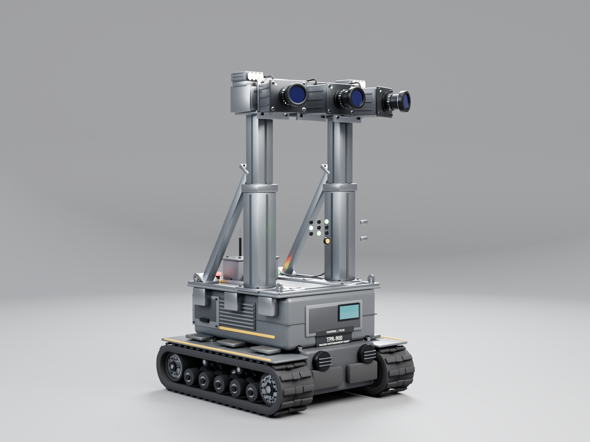
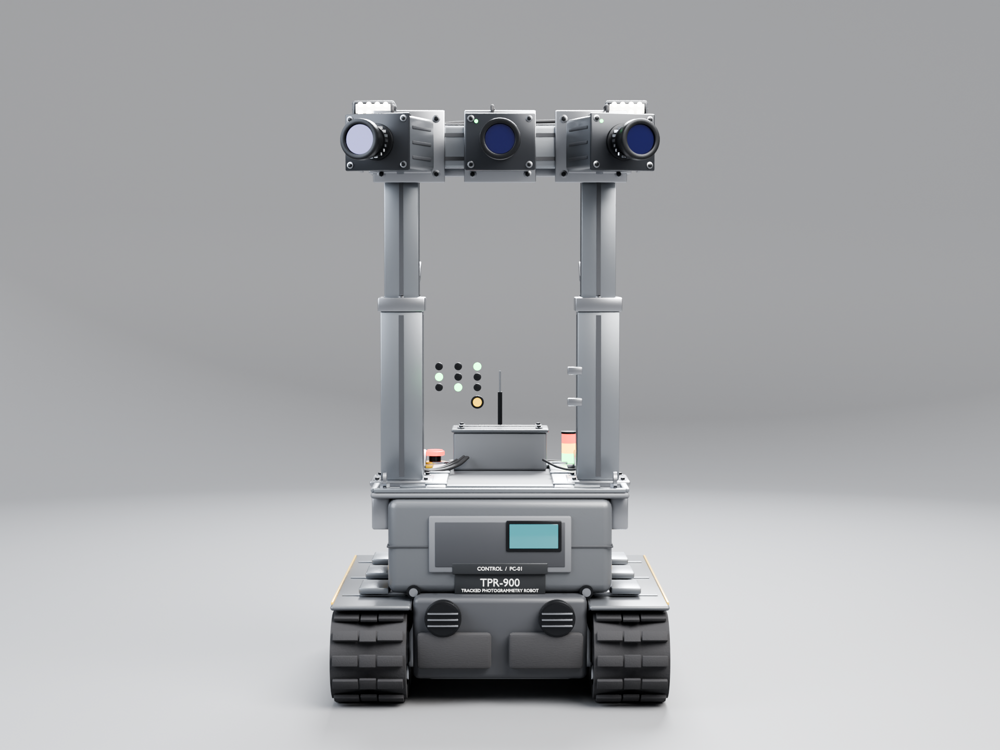
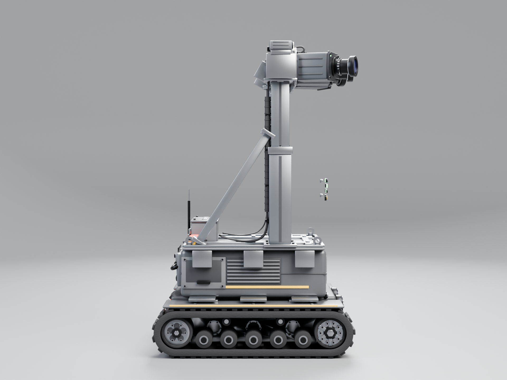
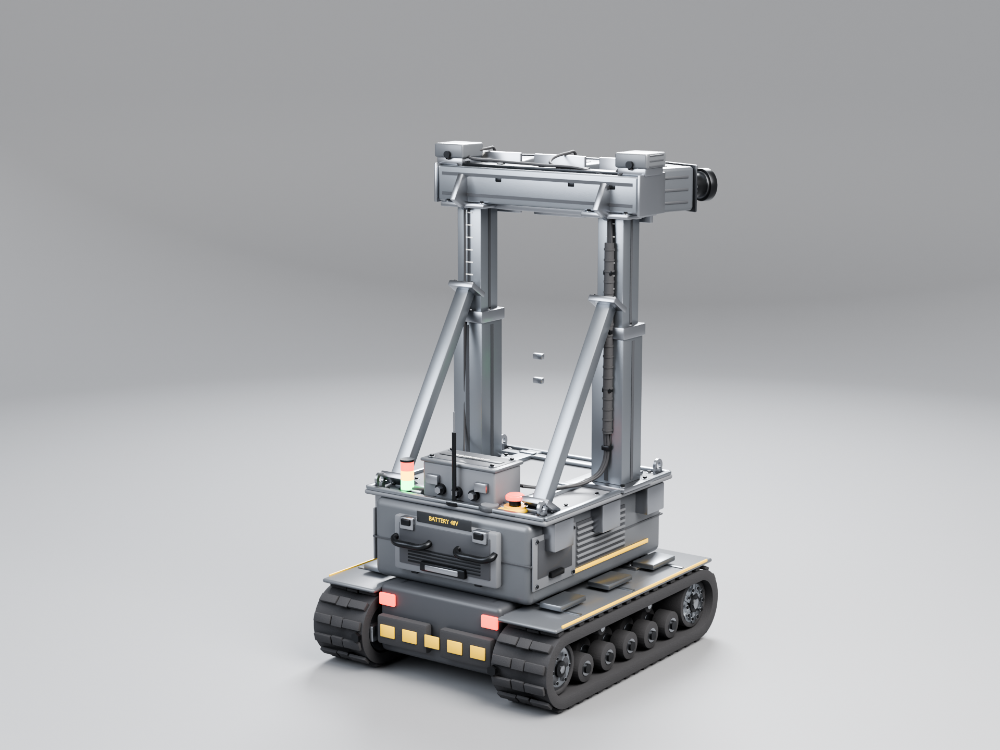
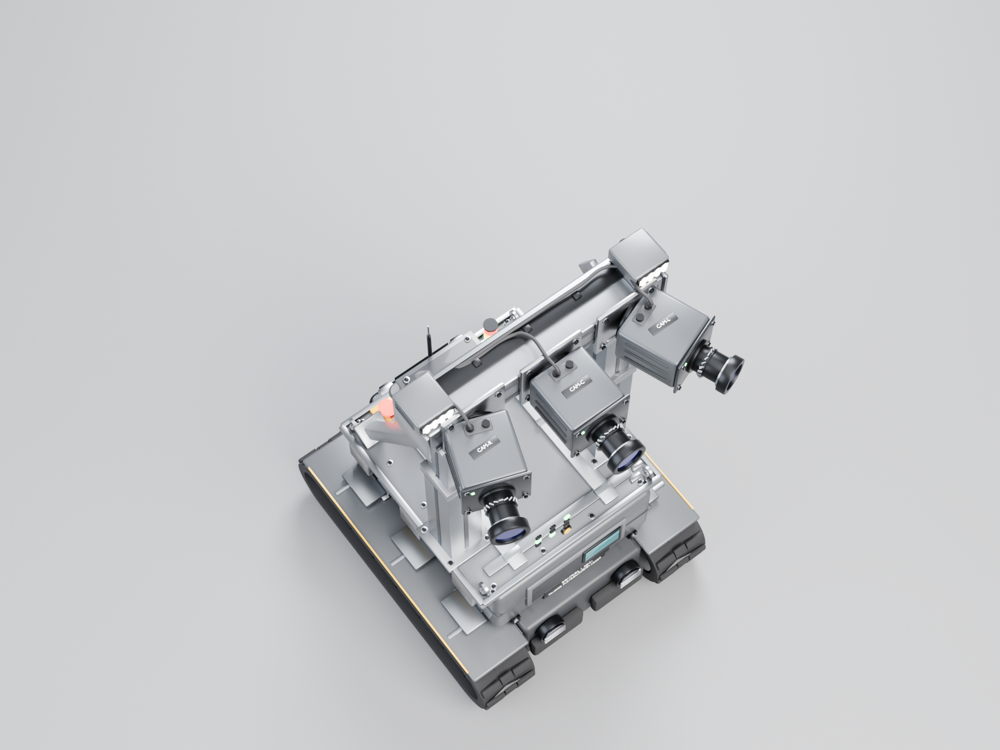
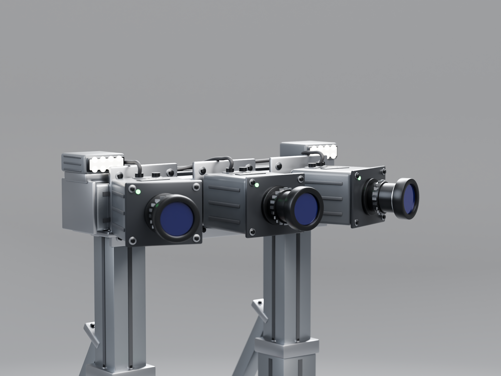
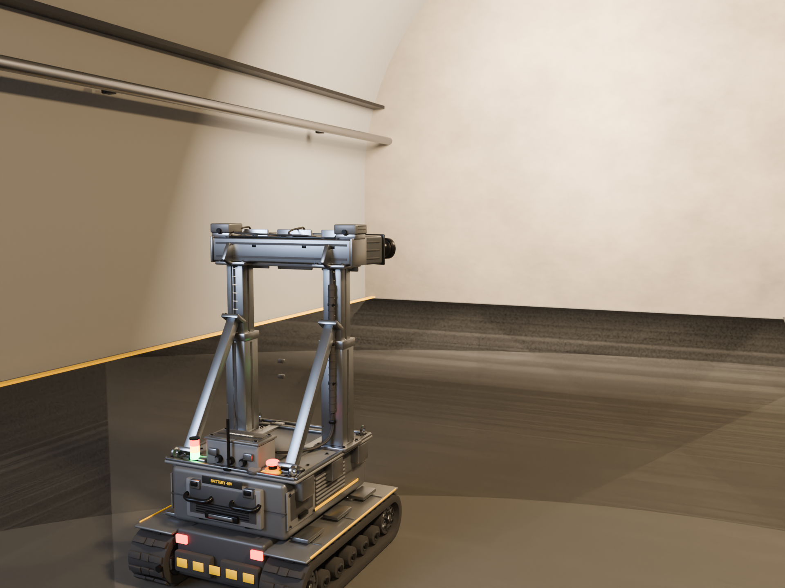

# TPR-900 履带式摄影测量机器人 · Blender 产品资产

> 面向隧道自主测绘、行驶、测量点停靠、摄影测量与掌子面素描动画的产品级 3D 资产。  
> 纯程序化建模（bmesh），无外部模型/贴图依赖；全部零件可单独选择、编辑，可用 `build_robot.py` 一键重建。

| 项目 | 说明 |
|---|---|
| Blender | 5.2.1 LTS（Cycles / OptiX） |
| 单位 | 米制，1 Blender Unit = 1 m；设计参数以 mm 书写，脚本内统一换算 |
| 坐标 | **+X 右，+Y 前，+Z 上，地面 Z = 0** |
| 机器人朝向 | 三相机头朝 +Y；左相机位于 -X，右相机位于 +X |
| 资产原点 | 机器人中心地面 (0, 0, 0) |
| 资产规模 | 128 个机器人网格、8 个控制 Empty、31 个材质、3 个场景 |

---

## 1. 交付清单

| 文件 | 大小 | 内容 |
|---|---|---|
| `Tracked_Photogrammetry_Robot.blend` | ≈ 3.4 MB | 主资产。3 个场景、128 个网格、31 个材质、8 个控制 Empty、6 台产品相机 + 1 台隧道相机、9 盏灯 |
| `Tracked_Photogrammetry_Robot.glb` | ≈ 10.5 MB | 仅机器人，glTF 2.0。136 个节点（128 网格 + 8 Empty）、25 个材质，根节点 `Robot_Root` |
| `Tracked_Photogrammetry_Robot.fbx` | ≈ 7.8 MB | 可选交换格式，仅机器人（EMPTY + MESH） |
| `Preview/01_Hero_ThreeQuarter.png` | 1920×1440 | 英雄 3/4 视图 |
| `Preview/02_Front_Camera_Array.png` | 1920×1440 | 正面 / 三相机阵列 |
| `Preview/03_Side_Profile.png` | 1920×1440 | 侧面 / 履带与支撑 |
| `Preview/04_Rear_ThreeQuarter.png` | 1920×1440 | 后 3/4 / 电池与电气 |
| `Preview/05_Top_Layout.png` | 1920×1440 | 俯视布局 |
| `Preview/06_Photogrammetry_Closeup.png` | 1920×1440 | 摄影测量头特写 |
| `Preview/07_Tunnel_Context.png` | 1920×1440 | 隧道场景（附加） |
| `build_robot.py` | ≈ 106 KB | 完整程序化建模、材质、场景、渲染、导出脚本 |
| `README.md` | — | 本文件 |
| `Preview/work/` | — | 构建/渲染日志与诊断剪影，不属于六张成品图 |

> 六张产品图与一张隧道图均为 **Cycles GPU（OptiX）· 1920×1440 · 128 samples · Denoise · AgX Medium High Contrast**。  
> RTX 5070 上单张约 9–10 s，七张合计约 77 s；`--quick` 为 960×720 / 32 samples。

---

## 2. 快速开始

1. 用 Blender 5.2+ 打开 `Tracked_Photogrammetry_Robot.blend`。默认活动场景为 **`01_Robot_Asset`**（干净资产，无灯光/相机，便于编辑与导出）。
2. 切换到 **`02_Product_Studio`**：场景相机默认是 `01_Hero_ThreeQuarter`，按 `F12` 即可渲染；在 Outliner 中选择其它五台相机并设为场景相机，即可复现对应图片。
3. 切换到 **`03_Tunnel_Preview`**：场景相机为 `Tunnel_Camera`，可直接渲染隧道语境图。
4. 导入 GLB：`File > Import > glTF 2.0`。根节点为 `Robot_Root`，整机高 1.4 m；材质为 PBR 金属/粗糙度，程序化凹凸不会随 GLB 导出。
5. 渲染设置已保存在场景中：Cycles、GPU、1920×1440、128 samples、Denoise、AgX Medium High Contrast；产品场景曝光 0.0，隧道场景曝光 0.55。

---

## 3. 实际尺寸（mm）

| 项目 | 尺寸 | 说明 |
|---|---|---|
| **整机包络（含前伸镜头/遮光罩）** | **936.8 (Y) × 779.4 (X) × 1400.0 (Z)** | 由脚本对全部网格求包围盒得到 |
| **履带/底盘包络** | **900 × 780 × 220** | 履带长 900；两侧外缘 780；履带高 220 |
| 单条履带 | 900 × 172 × 220 | 橡胶带厚 30；履刺高 10；接地最低 Z = 0.0 |
| 驱动轮 / 诱导轮 | Ø140 × 120 | 中心 Z = 110，Y = ±340（前/后） |
| 负重轮 | Ø76 × 58，5 对/侧 | 中心 Z = 78，Y = −220 / −110 / 0 / 110 / 220 |
| 托带轮 | Ø40 × 46，2 对/侧 | 中心 Z = 190，Y = ±120 |
| 下框 | 400 × 760 × 190 | Z 60–250 |
| 上壳 | 520 × 660 × 220 | Z 250–470 |
| 顶部平台 | 600 × 640 × 14 | Z 470–484 |
| 支撑立柱 | 100 × 100（下段）/ 82 × 82（上段） | X = ±235，Z 484–1240；套筒接头 Z = 900，带锁紧卡箍 |
| 前横梁 | 660 × 120 × 100 | Z 1240–1340，Y 60–180 |
| 相机机身 | 150 × 160 × 120，3 台 | 中心 Z = 1290，Y = 180；中心 0°；左相机朝 −X 外偏 20°；右相机朝 +X 外偏 20° |
| 镜头前端 | Y ≈ 471（玻璃 ≈ 464） | 含遮光罩的最外点 Y = 480.8 |
| LED 补光 | 100 × 100 × 40，2 台 | X = ±300，Z 1360–1400 |

> **关于 900 与 936.8**：900 mm 是履带/底盘包络；三相机头的前伸镜头与遮光罩超出履带前端约 31 mm，因此整机包围盒长 936.8 mm。宽 779.4 mm、高 1400.0 mm 与设计值一致。  
> **地面接触**：履带履刺最低点 Z = 0.0；轮系、车体、支撑均在 Z > 0。

---

## 4. 场景与渲染

### 4.1 `01_Robot_Asset`
- 机器人集合 `Robot_Root`，原点在中心地面；无灯光、无相机，世界背景深灰 (0.035, 0.038, 0.042)，强度 0.6。
- 用于资产编辑、GLB/FBX 导出和动画引用；不建议在此场景直接出图。

### 4.2 `02_Product_Studio`
- 圆形无缝影棚：地面半径 4.2 m，圆弧过渡至 5.5 m，背景墙到 Z = 7 m；地面 Z = −0.002 m；中性灰 `MAT_Studio_Cove` (0.16, 0.163, 0.17)，粗糙度 0.66。
- 灯光：主光 850 W / 3.2 m（42°）、辅光 260 W / 2.6 m（−58°）、轮廓光 700 W / 2.0 m（172°）、顶光 260 W / 4.0 m；世界强度 0.45。
- 六台相机：

| 相机 | 位置 (m) | 目标 (m) | 镜头 | 光圈 | 画面重点 |
|---|---|---|---|---|---|
| `01_Hero_ThreeQuarter` | (3.10, 3.60, 0.98) | (0, 0.08, 0.77) | 65 mm | f/5.6 | 低角度右前 3/4，整机比例、履带、支撑、三相机头 |
| `02_Front_Camera_Array` | (0, 4.80, 1.00) | (0, 0, 0.74) | 70 mm | f/8 | 正面，三镜头、LED、铭牌、前灯 |
| `03_Side_Profile` | (4.70, 0, 0.90) | (0, 0, 0.73) | 70 mm | f/8 | 右侧面，900 mm 履带轮廓、轮系、悬挂、立柱、横梁 |
| `04_Rear_ThreeQuarter` | (3.00, −4.30, 1.80) | (0, −0.10, 0.80) | 70 mm | f/8 | 右后 3/4，电池抽屉、接线箱、E-stop、状态灯、反光条 |
| `05_Top_Layout` | (1.25, 1.65, 5.20) | (0, 0, 0.95) | 70 mm | f/8 | 俯视 3/4，三相机/LED 布局、横梁、履带间距、平台设备 |
| `06_Photogrammetry_Closeup` | (1.85, 2.65, 1.60) | (0, 0.28, 1.32) | 100 mm | f/4 | 摄影测量头特写，镜头玻璃、遮光罩、LED、CAM-L/C/R 标签、安装板 |

### 4.3 `03_Tunnel_Preview`
- 隧道断面：半宽 4 m、起拱线 Z = 2 m、拱顶 Z = 6 m；衬砌沿 Y = −12…9 m 扫掠，Solidify 0.30 m、Displace 0.16 m；环向肋 Y = −9, −6, −3, 0, 3, 6 m。
- 地面、黄色警示条、排水沟、管线/桥架、掌子面（Y = 9 m，位移 0.55 m）、薄雾（密度 0.0045）。
- 灯光：3 盏 380 W 暖色作业灯（Y = −6, −1, 4）、掌子面 2200 W 主光、420 W 冷色补光。
- 相机：35 mm，位置 (1.70, −2.60, 1.45)，目标 (0, 1.20, 1.00)；曝光 0.55。
- 机器人通过共享集合链接进该场景；GLB/FBX 不包含隧道与影棚。

### 4.4 六张产品图说明

1. **`01_Hero_ThreeQuarter.png`** — 低角度右前 3/4。中性灰无缝背景，主光从左上压出石墨灰车体的转折，履带、支撑立柱、三相机头形成完整剪影。
2. **`02_Front_Camera_Array.png`** — 正面。三只镜头（中间前视、左右各外偏 20°）、两盏 LED、前保险杠、TPR-900 铭牌与前作业灯。
3. **`03_Side_Profile.png`** — 右侧面。900 mm 履带、驱动/诱导/负重轮、悬挂臂、张紧器、外护板、立柱与横梁的层叠关系。
4. **`04_Rear_ThreeQuarter.png`** — 右后 3/4。电池抽屉与拉手、接线箱、E-stop、状态灯柱、尾部反光条、后保险杠。
5. **`05_Top_Layout.png`** — 俯视 3/4。三相机与双 LED 的对称布局、前横梁、相机安装板、平台上的接线箱/急停/天线、两侧履带间距。
6. **`06_Photogrammetry_Closeup.png`** — 摄影测量头特写。镜头玻璃的深蓝紫镀膜、遮光罩、LED 蜂窝扩散板、CAM-L/C/R 标签、机身散热肋与连接器。
7. **`07_Tunnel_Context.png`**（附加）— 隧道语境。掌子面、衬砌肋、黄色警示条、管线、薄雾与作业灯，机器人在隧道中占比适中。

**渲染预览**















---

## 5. 集合与对象组织

```
Robot_Root (Empty, 0,0,0)
├─ 01_Chassis
│  ├─ Main_Body
│  │   Chassis_LowerFrame, Chassis_SkidPlate, Chassis_UpperShell, Chassis_ShellSeam,
│  │   Chassis_TopPlatform, Chassis_PlatformRail, Chassis_PlatformGussets,
│  │   Chassis_SideSteps, Chassis_TrackMounts
│  ├─ Battery_Compartment
│  │   Battery_Drawer, Battery_Handle, Battery_Latches, Battery_Label_plate, Battery_Label_text
│  ├─ Control_Compartment
│  │   Control_Panel, Control_Display, Control_Buttons, Control_Hinges,
│  │   Control_Label_plate, Control_Label_text
│  └─ Body_Details
│      Chassis_Bumpers, Chassis_BumperBolts, Chassis_Fasteners, Chassis_HandleMounts,
│      Chassis_Handle_L/R, Chassis_LiftingEyes, Chassis_NamePlate_Sub/plate/text,
│      Chassis_PlatformRails, Chassis_ServiceHatch_L/R, Chassis_SideStripe_L/R,
│      Chassis_SideVent_L/R, Chassis_TailLights, Chassis_WorkLight_L/R
├─ 02_Left_Track          (X = −300 mm)
│  ├─ Track_Belt          Track_Belt_L
│  ├─ Drive_Wheel         Drive_Wheel_L
│  ├─ Idler_Wheel         Idler_Wheel_L
│  ├─ Road_Wheels         Road_Wheel_L_01…05, Return_Roller_L_01/02
│  └─ Track_Frame         Track_Frame_L, Track_FrameDetails_L, Track_Tensioner_L,
│                         Track_Suspension_L, Track_Fender_L, Track_FenderBracket_L
├─ 03_Right_Track         (X = +300 mm；子集合因 Blender 全局唯一命名显示为 .001，
│                          对象均以 _R 结尾)
├─ 04_Camera_Support
│  ├─ Left_Pillar         Support_BasePlate_L, Support_PillarLower_L, Support_ClampCollar_L,
│  │                      Support_PillarUpper_L, Support_TopPlate_L, Support_BeamGusset_L,
│  │                      Support_Brace_L
│  ├─ Right_Pillar        ……_R
│  ├─ Cross_Beam          Support_CrossBeam
│  └─ Mounting_Brackets   Support_CameraPlates, Support_LEDRisers, Support_CableClips
├─ 05_Photogrammetry
│  ├─ Camera_Left         Camera_Left（含 CAM-L 标签，X = −215）
│  ├─ Camera_Center       Camera_Center（CAM-C，X = 0）
│  ├─ Camera_Right        Camera_Right（CAM-R，X = +215）
│  ├─ LED_Left / LED_Right
│  └─ Cabling             Cable_Cam_Left/Center/Right, Cable_LED_Left/Right,
│                         Cable_Sleeve, Cable_Clips, Cable_Clips_Beam
├─ 06_Electrical
│   Chassis_Bulkhead, Elec_JunctionBox, Elec_JB_Label_plate/text,
│   Elec_EmergencyStop, Elec_EStop_Label_plate/text, Elec_StatusTower,
│   Elec_Antenna, Elec_GPS, Elec_Cable_JB_to_EStop, Elec_Cable_JB_to_Tower
└─ 07_Details
    Detail_ReflectiveStripes, Detail_ServiceQR, Detail_TieDowns,
    Cable_TrackMotor_Left/Right, Cable_Gland_Left/Right
```

**8 个控制 Empty（也是 GLB 的 8 个空节点）**

| Empty | 世界位置 (m) | 作用 |
|---|---|---|
| `Robot_Root` | (0, 0, 0) | 整机总控 |
| `Chassis_Root` | (0, 0, 0) | 车体总成 |
| `Left_Track_Root` | (−0.30, 0, 0) | 左履带总成（X = −300） |
| `Right_Track_Root` | (+0.30, 0, 0) | 右履带总成（X = +300） |
| `Camera_Support_Root` | (0, 0, 0.484) | 整个相机支撑门架 |
| `Camera_Array_Root` | (0, 0.18, 1.29) | 三相机 + LED + 线缆的整体云台 |
| `Electrical_Root` | (0, 0, 0) | 电气件总成 |
| `Details_Root` | (0, 0, 0) | 贴纸/系留点等细节总成 |

> **命名约定**：左 = −X，右 = +X；所有 `_L` 对象在 −X，`_R` 在 +X。右侧子集合因 Blender 集合名全局唯一，自动带 `.001` 后缀，但对象名仍为 `_R`。  
> 所有 128 个机器人网格均为独立对象，可在 Outliner 或 3D 视图中单独选择、隐藏、赋材质、加修改器。

---

## 6. 材质

| 材质 | 基础色 (线性) | 金属度 | 粗糙度 | 用途 |
|---|---|---|---|---|
| `MAT_Body_Graphite` | (0.075, 0.080, 0.088) | 0.32 | 0.40 | 车体主石墨灰 |
| `MAT_Body_Graphite_Dark` | (0.034, 0.036, 0.041) | 0.25 | 0.52 | 凹槽、内框、暗部 |
| `MAT_Panel_Graphite` | (0.105, 0.110, 0.120) | 0.15 | 0.55 | 检修门/面板 |
| `MAT_Rubber_Track` | (0.017, 0.017, 0.019) | 0.00 | 0.88 | 履带橡胶 |
| `MAT_Rubber_Bumper` | (0.022, 0.022, 0.024) | 0.00 | 0.95 | 保险杠/缓冲 |
| `MAT_Aluminium` | (0.520, 0.545, 0.575) | 1.00 | 0.33 | 支撑立柱、横梁 |
| `MAT_Aluminium_Dark` | (0.235, 0.250, 0.270) | 1.00 | 0.38 | 型材、支架 |
| `MAT_Steel_Dark` | (0.300, 0.310, 0.330) | 1.00 | 0.30 | 螺栓、销轴、结构件 |
| `MAT_Black_Anodized` | (0.018, 0.019, 0.021) | 0.85 | 0.34 | 黑色阳极氧化件 |
| `MAT_Camera_Housing` | (0.055, 0.060, 0.068) | 0.35 | 0.36 | 相机机身 |
| `MAT_Camera_FrontPlate` | (0.022, 0.024, 0.028) | 0.55 | 0.28 | 相机前板 |
| `MAT_Lens_Glass` | (0.016, 0.020, 0.058) | 0.10 | 0.03 | 镜头玻璃（透射 0.55 + 蓝紫镀膜） |
| `MAT_Lens_Inner` | (0.004, 0.004, 0.006) | 0.00 | 0.55 | 镜筒内壁 |
| `MAT_Engineering_Yellow` | (0.780, 0.470, 0.018) | 0.05 | 0.38 | 工程黄点缀 |
| `MAT_Indicator_Green` | (0.05, 0.50, 0.12) | 0.00 | 0.20 | 绿色状态灯（自发光 7） |
| `MAT_Indicator_Amber` | (0.60, 0.28, 0.01) | 0.00 | 0.20 | 琥珀色警示（自发光 7） |
| `MAT_Indicator_Red` | (0.50, 0.02, 0.01) | 0.00 | 0.25 | 急停/尾灯（自发光 5） |
| `MAT_LED_Emissive` | (1.0, 0.96, 0.88) | 0.00 | 0.25 | LED 灯珠（自发光 9） |
| `MAT_LED_Diffuser` | (0.82, 0.83, 0.80) | 0.00 | 0.45 | LED 扩散板（自发光 2.2） |
| `MAT_Display_Screen` | (0.008, 0.012, 0.014) | 0.00 | 0.12 | 控制屏（青色自发光 1.4） |
| `MAT_Label_White` / `_Yellow` / `_Plate` | — | — | — | 铭牌、标签、二维码底板 |
| `MAT_Cable_Black` / `MAT_Cable_Sleeve` | (0.014, 0.014, 0.016) | 0.00 | 0.62 / 0.78 | 线缆与波纹套管 |
| `MAT_Work_Light` | (1.0, 0.85, 0.65) | 0.00 | 0.30 | 前作业灯（自发光 35） |
| `MAT_Studio_Cove` | (0.160, 0.163, 0.170) | 0.00 | 0.66 | 影棚背景（仅场景） |
| `MAT_Tunnel_Concrete` / `_Floor` / `_Face_Rock` / `_Haze` | — | — | — | 隧道场景（仅场景） |

> GLB 导出 Principled BSDF 的基础色/金属度/粗糙度/自发光；程序化噪声凹凸与部分细节节点不会进入 GLB。需要最高画质时以 `.blend` 为准。

---

## 7. 动画控制建议

### 7.1 整机与行走
| 控制对象 | 建议动画 | 说明 |
|---|---|---|
| `Robot_Root` | 平移/旋转 | 整机沿隧道推进、转向；所有零件随之运动 |
| `Left_Track_Root` / `Right_Track_Root` | 独立平移/旋转 | 左右履带总成差速转向；对象原点在履带中心 |
| `Drive_Wheel_L/R` | 绕局部 X 旋转 | 驱动轮；原点在轮轴中心 |
| `Idler_Wheel_L/R` | 绕局部 X 旋转 | 诱导轮 |
| `Road_Wheel_L/R_01…05` | 绕局部 X 旋转 | 负重轮；可按行驶距离设不同转速 |
| `Return_Roller_L/R_01/02` | 绕局部 X 旋转 | 托带轮 |
| `Track_Belt_L/R` | — | 单网格静态履带；如需“履带滚动”，建议加 UV + Mapping 偏移做纹理滚动，或用形态键/曲线修改器；仅旋转轮系也能表达行走 |

### 7.2 摄影测量头
| 控制对象 | 建议动画 | 说明 |
|---|---|---|
| `Camera_Array_Root` | 平移/旋转 | 三相机 + LED + 线缆整体云台；对象原点 (0, 0.18, 1.29) |
| `Camera_Center` | 独立俯仰/偏航 | 中心前视，镜头局部 +Y |
| `Camera_Left` | 独立俯仰/偏航 | 位于 −X，基准向外 −X 偏 20°；标签 CAM-L 随动 |
| `Camera_Right` | 独立俯仰/偏航 | 位于 +X，基准向外 +X 偏 20°；标签 CAM-R 随动 |
| `LED_Left` / `LED_Right` | 独立开关/亮度 | 通过 `MAT_LED_Emissive` / `MAT_LED_Diffuser` 的自发光强度做补光闪烁 |
| `Camera_Support_Root` | 整体升降/旋转 | 整个支撑门架；用于运输/展开姿态 |

### 7.3 支撑高度（套筒式）
- 立柱在 **Z = 900 mm** 处分为下段 `Support_PillarLower_L/R` 与上段 `Support_PillarUpper_L/R`，外套 `Support_ClampCollar_L/R` 锁紧卡箍；这是“支撑高度可调”的结构表达。
- 需要做高度动画时，把以下对象作为一组一起移动（沿 Z）：
  `Support_PillarUpper_L/R`、`Support_TopPlate_L/R`、`Support_BeamGusset_L/R`、`Support_CrossBeam`、`Support_CameraPlates`、`Support_LEDRisers`、`Camera_Array_Root`（其子级相机/LED/线缆随动）。
- 小范围调整（约 0–30 mm）可由卡箍遮住接缝；大幅调整需同步移动卡箍，并重做/重绑 `Support_Brace_L/R` 斜撑。
- 当前未加驱动器/约束，保持资产干净、可自由绑定。

### 7.4 其它可独立控制的细节
| 对象 | 控制方式 |
|---|---|
| `Battery_Drawer` + `Battery_Handle` + `Battery_Latches` + `Battery_Label_*` | 电池抽屉沿 −Y 抽出；四者为独立对象，做动画时请一起打关键帧，或把后三者父级到 `Battery_Drawer` |
| `Control_Display` | 通过 `MAT_Display_Screen` 自发光/贴图做屏幕内容变化 |
| `Chassis_WorkLight_L/R`、`Chassis_TailLights`、`Elec_StatusTower`、`Elec_EmergencyStop` | 通过对应自发光材质做开关/告警闪烁 |
| `Cable_Cam_Left/Center/Right`、`Cable_LED_*` | 已父级到 `Camera_Array_Root`，随云台整体运动；单个相机偏航时线缆不会自动跟随，需要加约束或重设末端 |
| `Chassis_ServiceHatch_L/R`、`Control_Panel` | 静态；可手动加铰链/旋转做开合 |
| `Elec_Antenna`、`Elec_GPS` | 静态；可单独旋转 |

---

## 8. 重建与修改

```bash
# 完整重建 + 七张 1920×1440 / 128 samples 渲染
blender -b -P build_robot.py

# 只重建资产与 GLB/FBX，不渲染
blender -b -P build_robot.py -- --no-render

# 快速迭代：960×720 / 32 samples
blender -b -P build_robot.py -- --quick
```

- 脚本入口在 `main()`；依次执行：清空场景 → 建集合/Empty → 车体 → 履带 → 支撑 → 相机/LED → 电气/细节/线缆 → 影棚/灯光/相机 → 隧道场景 → 保存 `.blend` → 导出 GLB/FBX → 渲染。
- **尺寸参数**集中在文件顶部 `P` 字典（全部 mm）：`track_len`、`track_w`、`wheel_r`、`up_w`、`pillar_x`、`cam_x`、`cam_yaw` 等；改完直接重建即可。
- **材质**在 `build_materials()`；**集合**在 `build_collections()`；**相机**在 `build_studio_scene()` 的 `views` 列表；**隧道**在 `build_tunnel_scene()`。
- 重建会覆盖同名 `.blend/.glb/.fbx` 和 `Preview/` 图片；`Preview/work/` 保留构建日志。
- 默认使用 OptiX GPU；无 NVIDIA 显卡时把 `setup_render()` 中的 `scene.cycles.device` 改为 `'CPU'`，并适当降低 samples。

---

## 9. 校验记录

| 检查项 | 结果 |
|---|---|
| `.blend` 打开 | 正常；3 个场景 `01_Robot_Asset` / `02_Product_Studio` / `03_Tunnel_Preview`，默认活动场景为资产场景 |
| 结构 | 37 个集合、160 个对象；机器人层级 136 个对象（128 网格 + 8 Empty） |
| 包围盒 | min = (−0.3897, −0.4560, 0.0000) m；max = (0.3897, 0.4808, 1.4000) m |
| 尺寸 | 779.4 × 936.8 × 1400.0 mm（X × Y × Z） |
| 地面接触 | 履带最低 Z = 0.0 mm；无零件低于地面 |
| 相机朝向 | 左 (−0.342, 0.940, 0)；中 (0, 1, 0)；右 (+0.342, 0.940, 0)，均朝 +Y 并向外偏 20° |
| 左右命名 | `Left_Track_Root` X = −0.30；`Right_Track_Root` X = +0.30；`Camera_Left` X = −0.215；`Camera_Right` X = +0.215 |
| 支撑连接 | 立柱底座坐在平台 Z = 484；横梁/相机板/LED 支架/斜撑连续；履带通过 `Chassis_TrackMounts` 与下框连接 |
| GLB 重导入 | 136 节点（128 网格 + 8 Empty）、25 材质、根 `Robot_Root`；包围盒与 `.blend` 完全一致；对象名保留 |
| 渲染 | 六张产品图 + 一张隧道图，1920×1440，128 samples；平均亮度 0.52–0.79，无大面积死黑/过曝 |
| 独立性 | 128 个网格均可单独选择；左右履带、三相机、双 LED、轮系、支撑上下段、电池抽屉、电气件均为独立对象 |

---

## 10. 已知限制

1. **整机长 936.8 mm** 含前伸镜头/遮光罩；900 mm 是履带/底盘包络。若必须严格 900 mm，可将三相机整体后移约 31 mm（改 `P["cam_mount_y"]`），但相机安装板会部分埋入横梁。
2. **履带带体是静态单网格**；轮系可独立旋转。真实“履带滚动”需加 UV 纹理滚动、形态键或曲线修改器，资产本身未绑定。
3. **支撑高度是结构式可调**（套筒 + 卡箍 + 可整体移动的上段组），未加驱动器；大幅升降需同步斜撑。
4. **GLB/FBX 仅含机器人**；影棚、灯光、隧道、相机不导出。GLB 不含程序化凹凸，PBR 基础值保留。
5. **文字标签是 FONT 转网格**，不是可编辑文本；二维码为风格化图案，非可扫描码。
6. **电池抽屉/控制面板**由多个独立对象组成，做开合动画时需一起打关键帧或重新父级。
7. 右侧履带子集合显示为 `Track_Belt.001` 等（Blender 全局唯一命名），对象名仍为 `_R`。
8. 模型是视觉资产，未做水密/3D 打印壁厚优化。

---

## 11. 文件路径

```
E:\横向项目\5=侨城东路\掌子面智能地质素描开发\robot\Tracked_Photogrammetry_Robot\
├─ Tracked_Photogrammetry_Robot.blend
├─ Tracked_Photogrammetry_Robot.glb
├─ Tracked_Photogrammetry_Robot.fbx
├─ build_robot.py
├─ README.md
└─ Preview\
   ├─ 01_Hero_ThreeQuarter.png
   ├─ 02_Front_Camera_Array.png
   ├─ 03_Side_Profile.png
   ├─ 04_Rear_ThreeQuarter.png
   ├─ 05_Top_Layout.png
   ├─ 06_Photogrammetry_Closeup.png
   ├─ 07_Tunnel_Context.png
   └─ work\   （构建日志/诊断图）
```
